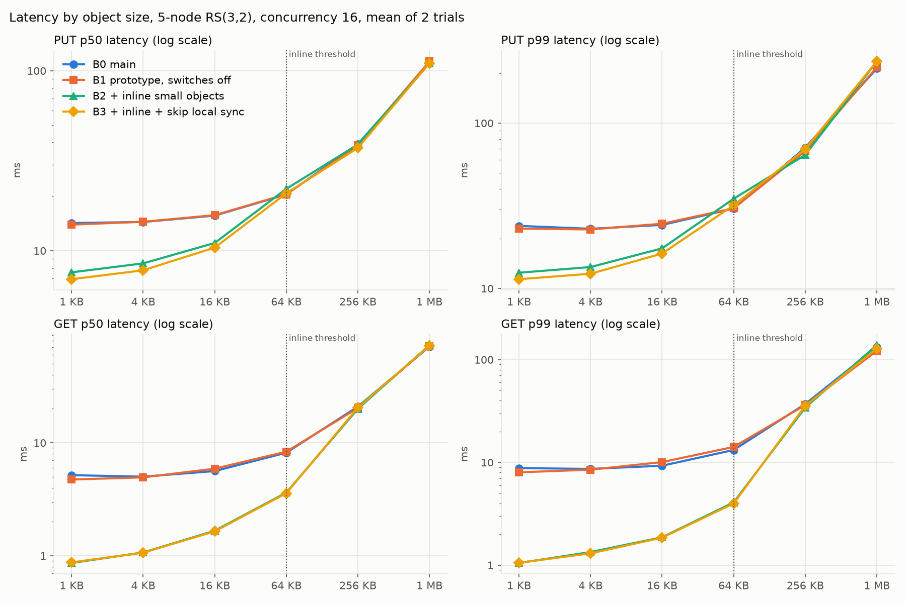
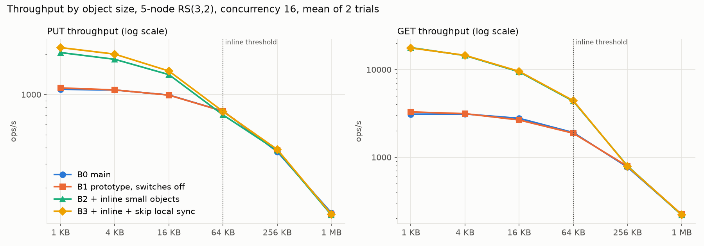
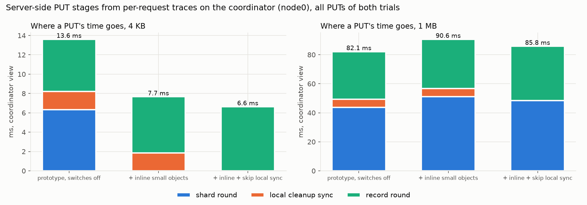
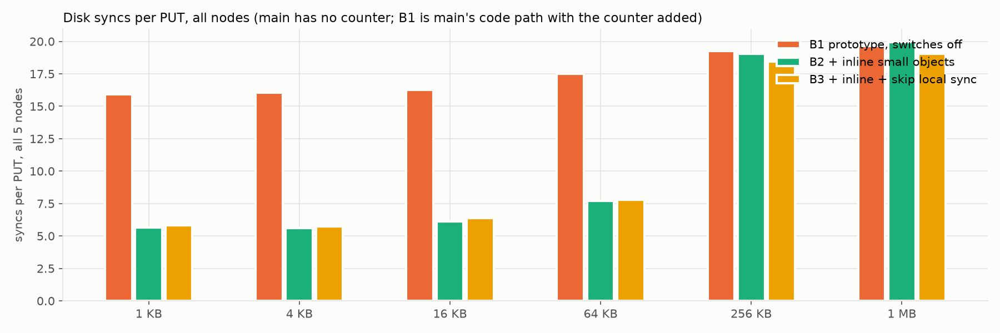
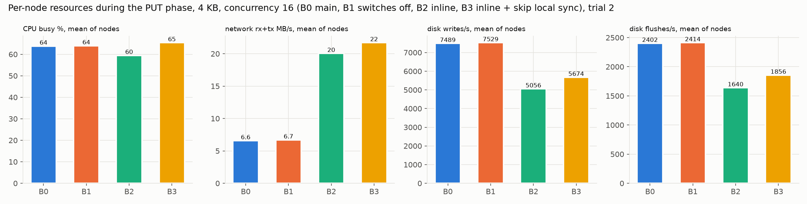
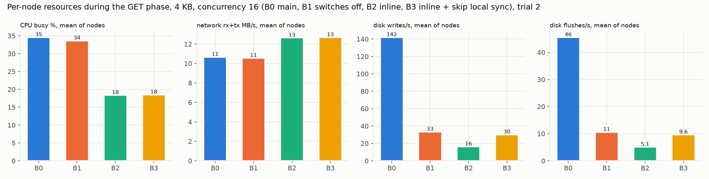
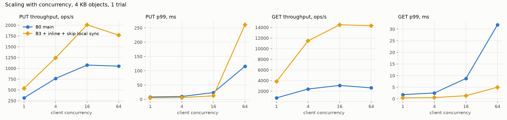

# RFC 5 - One S3 Object Service with Pluggable Components

**Status:** Proposed. Option B chosen. Write/read path techniques T1-T2 prototyped and measured (see *Measured results*).
**Branch:** `feat-rfc5-one-object-service`

---

## Problem

WarpDrive has two S3 implementations.

| | Single node | Cluster |
|---|---|---|
| S3 handlers | 25 functions in `s3/handlers/` (~5,500 lines) | 8 functions in `cluster/s3_surface.rs` + `coordinator.rs` (~2,600 lines) |
| Metadata | `MetadataService` over `MetadataStorage`, implemented by `SQLiteMetadataStore` (versions, ACLs, multipart, Object Lock, buckets) | `LocationStore` / `ContentLocationStore` / `BucketConfigStore`. No versions, no ACL storage, no bucket registry. |

PR #175 extended `MetadataStorage` to cover the cluster, but its cluster implementation (`ClusterMetadataStore`) is read-only. Every write method returns an error, because the trait assumes bytes are written before metadata, while the cluster writes data, placement and metadata in one step. So cluster writes went around the trait, and the cluster grew its own handlers. PR #187 unified the S3 URL, but `/s3/...` still dispatches to one handler set or the other.

The result, measured with the Ceph suite on a 5-node RS(3,2) cluster (two identical runs, 2026-11-19): 245 tests pass. 207 tests that `docs/TEST-COVERAGE.md` lists as passing on single node fail on the cluster:

| Area | Tests | Main cause |
|---|---|---|
| Listing | 54 | No delimiter/common prefixes, paging, encoding-type. Fake LastModified/ETag. |
| Multipart | 34 | Missing response fields and input validation. #214. |
| Object Lock | 28 | No version IDs. |
| Versioning | 20 | Cluster has no versions (#211). |
| ACLs | 18 | ACL calls return 500. |
| Copy | 11 | Missing validation, metadata not carried over. |
| Form POST | 8 | Stored by the single-node engine (#213). |
| Other | 34 | Mostly missing error responses. |

Almost none of these are coordination problems. They are features that exist in the single-node stack and were never rebuilt for the cluster.

## Goals

1. **S3 semantics exist once.** One handler module and one object service, used by every deployment.
2. **Cluster engine everywhere.** A single-node deployment is a 1-node cluster with RS(1,0).
3. **Composable.** Metadata store, placement, layout/codec, transport and pushdown are pluggable components, chosen per deployment, bucket or request.
4. **Performance is retained or improved.** Measured gates below, on the same hardware as today's numbers.
5. **`LocationStore` stays swappable,** so it can become a Raft-replicated service later without changes above it.

Non-goals: building Raft now, and migrating existing data. WarpDrive hasn't shipped, so there's no installed data to carry over.

## Options considered

**A. One S3 module over one engine trait.** Simplest. The trait would speak only S3 operations, so placement, layout and pushdown would be forced through it or bolted on beside it. That's how the second stack appeared last time. Rejected.

**B. Layered, with explicit extension points.** Chosen. Described below.

**C. Keep two stacks.** Today's state, and the cause of the gap. Rejected.

## Design (option B)

```
S3 protocol module      auth (SigV4, STS), XML, error codes, the 25 handlers. Written once.
        │
Object service          S3 semantics: versions, ACLs, multipart, Object Lock, listing,
        │               bucket registry. One implementation, tested by the Ceph suite.
        ├── MetadataStore     ReplicatedLocationStore (default) │ SQLite (optional, single node) │ Raft (later)
        ├── PlacementPolicy   hash + RS (default) │ content-dependent │ WASM policies (#181, #182)
        ├── Layout / codec    plain erasure coding │ packed stripes │ column codecs (zlib_f64, ...)
        ├── Storage           per-node shard storage (today's .bin files, RFC 3 segments later)
        ├── Transport         gRPC │ TCP │ HTTP │ Local (N=1, no network)
        └── Capabilities      optional: pushdown query, computable units, packed range reads
```

### Components and where they come from

| Component | Today | Change |
|---|---|---|
| S3 protocol module | `s3/handlers/`, `s3/auth.rs` | Moved, not rewritten. Handlers call the object service instead of `MetadataService` and `StorageService` directly. |
| Object service | Logic spread across single-node handlers and `MetadataService` | Extracted into one engine-agnostic layer. |
| `MetadataStore` | `MetadataStorage` (69 methods) + `SQLiteMetadataStore`, read-only `ClusterMetadataStore` | Reshaped so a write carries the object record with its placement in one call. A writable cluster implementation replaces `ClusterMetadataStore`. |
| `PlacementPolicy` | `cluster/placement.rs`, already a trait (`place(bucket, key, peers, k, m)`) | Content-dependent placement and WASM policies implement it. |
| Layout / codec | `ReedSolomonCoder`, `cluster/packed.rs`, `ContentLocationStore`, `column_codecs` | One trait, chosen per bucket (`BucketConfigStore`) or per request (`x-warpd-computable-units`). Adds the no-parity coder for RS(1,0). |
| Storage | `shard_storage.rs`, `ShardMetaStore` | Behind a trait so RFC 3 (segment storage with space reclamation) can replace it. |
| Transport | `PeerClient` trait, already pluggable (gRPC/HTTP/TCP) | Adds `Local` for N=1, so a node never sends shards to itself over the network. |
| Capabilities | `/cluster/{bucket}/{key}/query`, packed reads | Exposed by the object service. The fast paths call their component directly, so no generic layer sits between them and the data. |

### Single node: RS(1,0)

- A single-node deployment runs the cluster engine with one node and RS(1,0): one data shard, no parity.
- The no-parity coder was tried in #187 (`PlainCoder`, `WARPDRIVE_RS_M=0`) and removed after decode bugs. It comes back with tests.
- Metadata defaults to the replicated `LocationStore` with N=1. `SQLiteMetadataStore` stays available as an optional backend for single-node deployments.
- RS(1,0) has no redundancy. A lost disk means lost data, and the docs must say so plainly.

### Write and read path: where WarpDrive can be fast

This section starts from what a request costs today, measured, not from another system's design.

**What a PUT costs today** (5-node RS(3,2), per-request traces and a sync counter, see *Measured results*):

1. Placement and encoding: microseconds.
2. **Shard round:** `put_shard` to the k+m holders. Each holder does two durable writes in sequence: the shard bytes, then the shard-index entry, each waiting for its own sync.
3. **Local cleanup:** the coordinator deletes any stale packed pin from its own store, a third sync in sequence. The broadcast in step 4 already sends that delete to this node, so it repeats work.
4. **Record round:** the `LocationRecord` goes to every node and is synced there, alongside the stale-pin broadcast (two more syncs per node).

So a small PUT costs about 16 syncs across the cluster and two network rounds, with up to three syncs waiting on each other. CPU (encode) is negligible. The cost is durable-write latency stacked in sequence.

**What a GET costs today:** one record lookup (local), then k shard fetches over the network, then decode, even for a 1 KB object.

The techniques below each remove a part of that cost. Each has its own switch so it can be measured alone.

| | Technique | What it removes | Status |
|---|---|---|---|
| T1 | **Inline small objects.** A small object's bytes go inside its `LocationRecord`, which is already replicated to every node with the write quorum. | PUT: the whole shard round. GET: every network hop, since the receiving node serves from its own copy. | Prototyped (`WARPDRIVE_INLINE_MAX_BYTES`) |
| T2 | **Drop the redundant local cleanup.** | One sync in sequence on every PUT. | Prototyped (`WARPDRIVE_SKIP_LOCAL_CLEANUP`) |
| T3 | **One durable append per shard write.** Shard bytes and the shard-index entry go into one log append with one sync. | One of the two sequential syncs on every shard holder. | Next |
| T4 | **Record rides with the shards.** Shard holders get the record in the same message as their shard, marked pending, and it goes live when write quorum is reached. Nodes that hold no shard get the record in parallel. | The second network round for sharded objects. | Next |
| T5 | **Local shard short-circuit.** When the coordinator holds a shard itself, read or write it directly instead of over gRPC to itself. Also covers N=1 (single node as RS(1,0)). | One network hop per request on the coordinator's own shard. | Next |
| T6 | **Hedged reads.** Ask for k+1 shards and decode from the first k that arrive. | Tail latency from one slow node. | Later |

**Durability stays the same.** T1 writes the record to the same quorum as today's records (3 of 5 nodes for RS(3,2)), each synced, so an acknowledged inline object survives losing any two nodes, like an erasure-coded one. T4 keeps the rule from #151: a record only becomes visible once its shards have reached write quorum.

**The cost T1 trades:** an inline object is stored on every node (5x for a 5-node cluster) instead of 1.67x. That's why the threshold matters: small objects are where per-request cost dominates and storage cost doesn't. The threshold is a tunable, defaulting to off in the prototype. Records also grow the location log, which needs the compaction work in RFC 3.

**Order:** T1 and T2 first (prototyped, measured below). Then T3 and T4 for sharded objects, then T5. T6 once the median is solved.

## Measured results (2026-11-19, prototypes T1 and T2)

**Setup:** GCP us-central1-a. 5 × `n2-standard-2` nodes, each with its own local NVMe SSD, RS(3,2), plus 1 client VM. Each run starts from empty data, then 10 s of PUTs and 10 s of GETs, concurrency 16, 2 trials. Scripts and raw data: `bench/`, `results/`.

| Variant | What runs |
|---|---|
| B0 | `main` (ade486b) |
| B1 | prototype binary, every switch off (adds traces and the sync counter) |
| B2 | B1 + T1 inline small objects (threshold 64 KB) |
| B3 | B2 + T2 skip the redundant local sync |

**Findings:**

1. **Tracing is free.** B0 and B1 match within trial spread at every size (4 KB PUT: 1,080 vs 1,081 ops/s).
2. **Small-object GET: ~4.6x throughput, ~5x lower latency, half the CPU.** At 4 KB, B3 serves 14,545 GET/s at p50 1.07 ms against `main`'s 3,112 at 5.01 ms. Node CPU during GET drops from 35% to 18%. The receiving node answers from its own record, with no shard fetches.
3. **Small-object PUT: ~1.9x throughput, ~half the latency.** At 4 KB, B3 does 2,007 PUT/s at p50 7.79 ms against 1,080 at 14.45 ms. Syncs per PUT fall from ~16 to ~5.7 across the cluster, and the coordinator's PUT time from 13.6 ms (shard round 6.3 + local sync 1.9 + record round 5.4) to 6.6 ms (record round only).
4. **T2 alone is worth ~8-9% on small PUTs** (B2 to B3: 1,835 to 2,007 PUT/s at 4 KB), for removing one sync.
5. **The inline benefit for PUT ends between 16 KB and 64 KB.** At 64 KB, PUT is flat or slightly worse (B1 749, B2 702, B3 745 ops/s): each inline object goes to all 5 nodes in base64 inside a JSON log line, so network per PUT rises ~3x (6.7 to 21 MB/s per node at 4 KB). GET still gains 2.3x at 64 KB. **A PUT-side threshold around 16 KB looks right**, and it could differ from the GET-side benefit.
6. **Sharded objects are unchanged.** At 256 KB and 1 MB, all four variants match within noise, as expected, since T1 doesn't apply above the threshold.
7. **Open: B3 PUT under high concurrency.** At concurrency 64 and 4 KB, B3 PUT drops to 1,768 ops/s with p99 260 ms, worse than `main` (1,049 ops/s, p99 115 ms). GET doesn't have this. Something saturates on the inline write path, likely the single location log per node or the all-node record fan-out. Not diagnosed yet. It must be fixed before T1 ships.

Full table: `results/results.md`.









CPU flamegraphs of the coordinator (4 KB, concurrency 16): `results/flame_B0.svg`, `results/flame_B3.svg`.

**Caveats:** Every variant logged at INFO on every request (access log plus trace lines, written to `logs/application.log`), so absolute numbers include logging cost for all of them, `main` too. Next runs: headline numbers at WARN, traces in separate or sampled runs. 2 trials per point (spread at 4 KB within ~1-2%). One client, all requests coordinated by node 0. Concurrency sweep is 1 trial. B0 has no sync counter, so its syncs/PUT is read from B1, which runs the same path.

## Performance gates

Every migration step re-runs these on the same hardware as the recorded baseline (3 trials, median). A step can't merge if a gate regresses beyond run-to-run noise.

| Gate | Baseline | Source |
|---|---|---|
| TPC-H Q6 on a packed bucket | 51.9 ms median, 149x vs plain | `docs/benchmarks/v1.0.0-results.md` |
| Lance `take`, nprobe 4 | 14.7 ms, 41x vs plain | `docs/benchmarks/v1.0.0-results.md` |
| vs MinIO, same client and hardware | 1.48-1.72x single node, ~3.0x on 5 nodes | PR #175, `docs/durability-and-minio-comparison.md` |
| Small-object PUT/GET, single node | to be re-measured at step 0 | new |
| Small-object PUT/GET, 5-node cluster | to be re-measured at step 0 | new |

Where performance can be lost, so the steps watch for it:
- **Extra buffer copies.** Bodies must pass through as `Bytes` from the handler to the codec.
- **An extra metadata hop** on reads or writes.
- **N=1 talking to itself** over gRPC. Prevented by the `Local` transport.
- Trait dispatch itself (nanoseconds) is negligible next to I/O.

Where it can be gained: T1-T5 above, measured one at a time.

## Migration plan

Each step is its own PR. Each must keep the Ceph enabled list green (`.github/ci/s3-compat-enabled.txt`), pass the performance gates, and add its newly passing tests to the list.

| Step | Change | Done when |
|---|---|---|
| 0 | Record baselines for every gate | Numbers committed |
| 1 | Component traits around today's code (Layout, Storage, MetadataStore shape). No behavior change. | Same Ceph results, same performance |
| 2 | Extract the object service from the single-node handlers onto `MetadataStore`. SQLite implements it. | Single node unchanged (Ceph count) |
| 3 | Writable cluster `MetadataStore` on `LocationStore`: objects, buckets (#199), multipart, versions, ACLs, Object Lock | Unit and integration tests |
| 4 | Route cluster requests through the one S3 module. Remove the cluster handlers in `cluster/s3_surface.rs`. | Cluster Ceph count matches single node (the 207 gap closes) |
| 5 | RS(1,0) and `Local` transport. Single node defaults to the cluster engine. SQLite becomes an opt-in setting. | Single-node gates hold |
| 6 | Write and read path: T1-T5, each behind its own switch until measured | Gates improve, Ceph list stays green |

Work that doesn't wait for this RFC: #206/#207 (partial-write repair, shard rebuild), space reclamation (RFC 3), #212 (stateless STS session tokens), #205 follow-ups. Work held until step 4: #214 and listing parity in `cluster/s3_surface.rs`, since that code is replaced.

## Open questions

1. **Versioning order without a leader.** Version IDs are time-ordered today. Is last-writer-wins by version ID acceptable for concurrent PUTs until a Raft-backed store exists?
2. **Inline threshold.** What default, and should it be per bucket? Measured below at 64 KB.
3. **Listing at scale.** `LocationStore::list` scans every key (#163). The `MetadataStore` interface should allow an ordered index.
4. **Configuration.** Name and shape of the setting that picks the metadata backend (replicated store vs SQLite).

## References

- Gap list and full cluster run: two Ceph runs on a local 5-node cluster, `main` @ 9d6fc85
- Benchmarks: `RFCs/RFC5/results/` (plots, per-run summary, analysis script)
