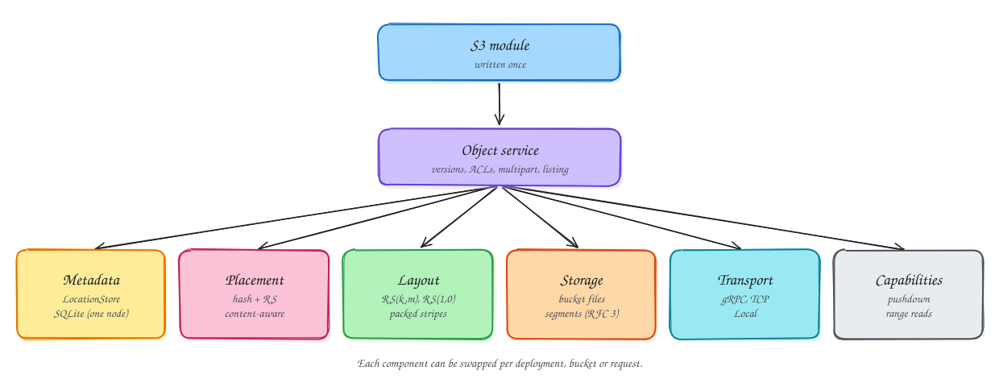
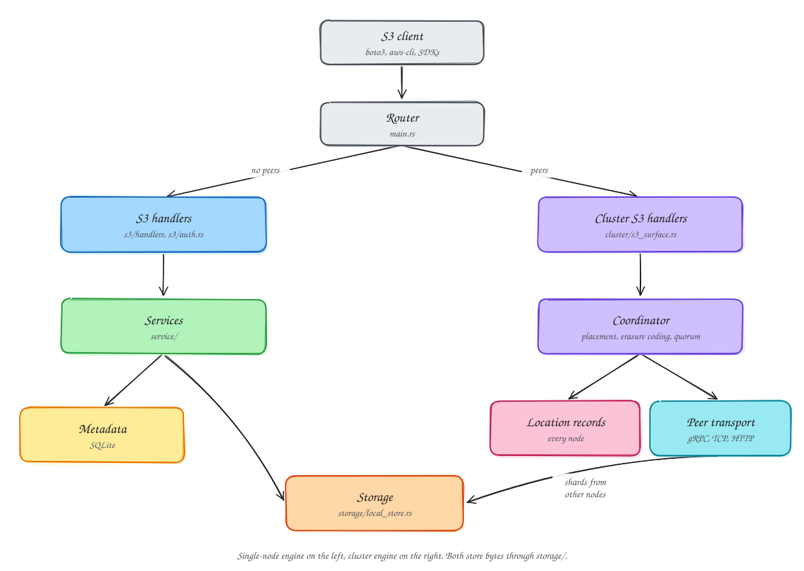
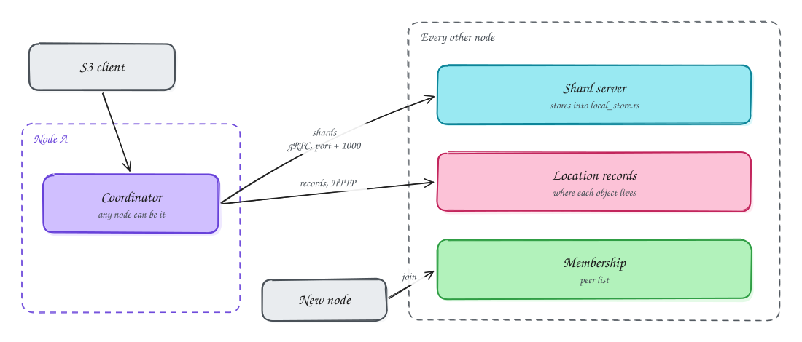
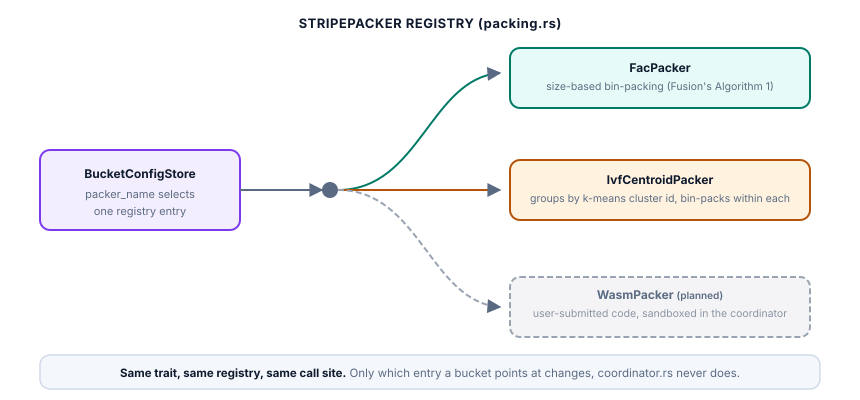
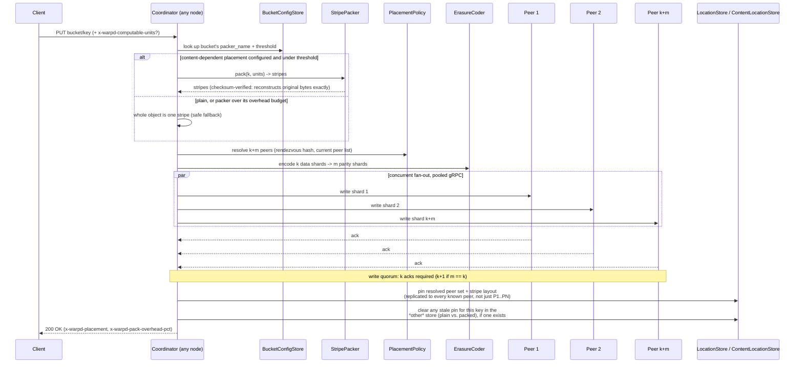
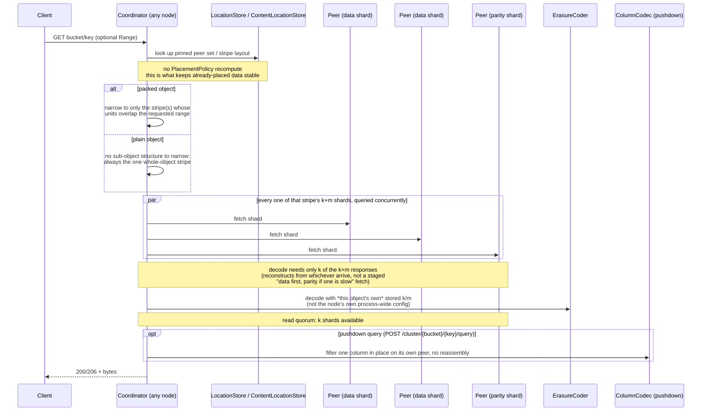

# WarpDrive Architecture Documentation

## Introduction

WarpDrive is an S3-compatible object store for disaggregated data systems
and AI/ML workloads. Its storage layout follows Facebook's Haystack paper:
objects are appended to large files, and a small record points at each one.

The architecture is set by [RFC 5](../RFCs/RFC5/RFC5-one-object-service.md):
one S3 module and one object service, with everything below them pluggable.
A single node is a one-node cluster. Space comes back through compaction, set
by [RFC 6](../RFCs/RFC6/). See [Implementation status](#implementation-status).

## Composable design

| Component | What plugs in |
|---|---|
| Metadata | Replicated rows in WarpMetaStore, on an engine: RocksDB (default), Bitcask, SQLite. Any ordered key-value store plugs in through `OrderedKv`. Raft later. |
| `PlacementPolicy` | Rendezvous hash (default), content-dependent packing, WASM policies |
| Layout / codec | RS(k,m), RS(1,0) on one node, packed stripes, column codecs |
| Storage | 64 MB segment files per bucket, freed by compaction and hole punching (RFC 6) |
| Transport | gRPC (default), TCP or HTTP for shards. Metadata rows go over HTTP, and a node applies its own locally. |
| Capabilities | Pushdown queries, computable units, packed range reads |

## How a request flows

| Module | Role |
|---|---|
| `s3/` | SigV4 and STS auth, the S3 handlers, lifecycle rules |
| Object service | S3 semantics: versions, ACLs, multipart, Object Lock, listing |
| `cluster/replicated_metadata.rs` | S3 metadata as rows replicated to every node. Each object's row holds its blobs' placements, and a read takes them from there. |
| `cluster/coordinator.rs` | Placement, erasure coding, quorum |
| `cluster/*_peer_client.rs` | Moves shards between nodes |
| `storage/` | 64 MB segment files with batched fsync |
| `cluster/gc.rs`, `compactor.rs` | Free dead shards: writes record what they kill, each node compacts its own disk |

### How nodes talk to each other

- **Shards** go to the `k+m` nodes placement picked. A write needs `k` acks
  (`k+1` when `m == k`). A read needs any `k`.
- **Metadata rows** go to every node, so any node can find any object.
- **Internal routes aren't authenticated yet** (#157). Keep them on a
  private network.

## Single node

A node started with no peers (no `WARPDRIVE_PEERS` or `WARPDRIVE_JOIN_VIA`)
is a cluster of one with RS(1,0). It runs the same engine as a cluster:
replicated metadata, the shard index, compaction and lifecycle.

- One data shard, no parity: losing the disk loses the data.
- Metadata is on RocksDB by default. Bitcask and SQLite are options.
- It sends its shards to itself over gRPC on loopback, and applies its own
  metadata rows locally. So it needs the same three ports as any node: HTTP,
  gRPC (+1000) and TCP (+2000).
- It refuses to start next to data from the old single-node engine
  (`metadata/metadata.sqlite`). There's no migration in the beta.

## Implementation status

RFC 5:

| Step | What | Status |
|---|---|---|
| T1, T2 | Inline small objects (opt-in), one less sync per PUT | Done, #217 |
| 1, 2 | Component traits, the object service on `MetadataStore` | Done, #217 |
| 3 | Writable cluster metadata: objects, buckets, multipart, versions, ACLs, Object Lock | Done, #226 (replicated rows) |
| 4 | One S3 module for clusters | Done for `/s3`, #226. The older `cluster/s3_surface.rs` is still mounted at `/cluster/s3/...` for content-dependent placement clients. |
| 5 | RS(1,0), single node on the cluster engine | Done, #244. A node's shards to itself go over gRPC on loopback: there's no separate `Local` transport. |

Since then:

| Change | PR |
|---|---|
| Compaction and space reclamation (RFC 6): segments, gc/ rows, the compactor, hole punching | #224 |
| WarpMetaStore as its own crate, engines behind `OrderedKv`, RocksDB as the default | #227, #237 |
| Reads carry each chunk's placement: no per-object index in memory | #238 |
| Bucket lifecycle (object expiry, noncurrent versions, stale uploads) | #234 |

## Cluster engine internals

Correctness review log: [`docs/reviews/v1.0.0-beta-code-review.md`](reviews/v1.0.0-beta-code-review.md).

Every deployed node is **symmetric**: the same binary, both a storage node
(it stores the shards it receives in 64 MB segment files, `local_store.rs`) and a coordinator that can accept a request, decide
placement, and fan out to peers. There is no
dedicated coordinator process and no leader election: consistent with how
MinIO and SeaweedFS run in production, placement is a deterministic function
of `(bucket, key)`, and consistency comes from a read/write quorum, not
consensus.

The write path and the read path are deliberately asymmetric, so it's worth
looking at them separately, plus a third diagram for how a bucket's
placement/packer choice actually gets wired up across the cluster's nodes.

### Cluster membership and per-bucket placement configuration

Three steps, each building on the last: a node joins the cluster, a bucket's
config picks a placement policy, and that config's `packer_name` selects one
entry from the `StripePacker` registry.

**1. A new node joins the running cluster.** No leader election, no
consensus. The joining node announces itself to every peer it currently
knows about over plain HTTP, best-effort: a peer that's briefly
unreachable during that round simply doesn't get the update, and that gap
isn't automatically repaired later (no gossip, no retry). In practice
(all peers reachable) every node converges on the same list. The failure
mode is a split list after a missed announce, not a hang or an error.

**2. A bucket's config resolves a `PlacementPolicy`.** The live peer list
from step 1, plus the bucket's own `packer_name`/`overhead_threshold_pct`,
feed `ComputedPlacement`'s rendezvous hash to pick the `k+m` peers for this
write.

**3. `packer_name` selects one `StripePacker` registry entry.** A bucket
only ever names a `packer_name`. Swapping in a new packer (native or,
once built, WASM) never changes `coordinator.rs` or any client-visible
behavior, only which registry entry a bucket's config points at.

### Write path

Placement is resolved **fresh** on every write and then pinned. This is
what makes "a node joining later never moves existing data" actually true.

### Read path

GET and DELETE **never** call `PlacementPolicy`. They read the pin that the
write path already recorded, regardless of what the peer list looks like
now.

**What each piece is, concretely (not aspirational, all shipped and tested
unless marked "planned"):**

- **`PlacementPolicy`** (`placement.rs`): `ComputedPlacement`, a CRUSH-style
  deterministic hash of `(bucket, key)` to a `k+m` peer set. Resolved fresh at
  PUT time and pinned into `LocationStore`. GET/DELETE read the pin, so a
  node joining or leaving never moves already-placed data.
- **`StripePacker`** (`packing.rs`): pluggable **content-dependent
  placement**, the opt-in layer on top of the always-on default above.
  `FacPacker` (Fusion's Algorithm 1, size-based bin-packing) and
  `IvfCentroidPacker` (groups by k-means cluster id, then bin-packs
  within each cluster) are both registered implementations of the same
  trait. A bucket picks one via `BucketConfigStore`, or uses neither and
  gets plain erasure-coded storage. Every packer's output is checked the
  same generic, packer-agnostic way before any shard is written: the
  stripes are reconstructed in memory and compared byte-for-byte against
  the original object, catching a dropped/duplicated/misplaced unit
  regardless of which algorithm produced it (not a bespoke check of any
  one packer's own logic). **Planned, not yet shipped:**
  `WasmPacker`: a user-submitted packer compiled to WASM, run sandboxed
  inside the coordinator process (no syscalls/network/filesystem access,
  resource-limited), simulated against a checksum of the original bytes
  for correctness before a bucket is ever allowed to go live on it. Same
  trait, same registry, same call site. Only the authoring path changes.
- **`ErasureCoder`** (`ec.rs`): `ReedSolomonCoder`, the `reed-solomon-erasure` crate
  encode/decode, with a second `encode_shards`/`decode_shards` path for
  pre-packed (content-dependent) stripes.
- **Metadata rows** (`replicated_metadata.rs`): every S3 object, version,
  bucket and upload as a row replicated to every node, newest stamp wins.
  An object's row holds its blobs' placements. `LocationStore` and
  `ContentLocationStore` keep the records the `/cluster/` API and
  content-dependent placement use.
- **`cluster/s3_surface.rs`**: the older S3 surface at `/cluster/s3/...`,
  kept for content-dependent placement clients (Lance, DuckDB). S3 clients use
  `/s3`, which goes through the shared S3 module.
- **`pushdown.rs`**: a `ColumnCodec` trait + a `/query` endpoint that filters
  a column in-place on the peer holding it, no whole-object reassembly.
- **Membership**: additive only (SeaweedFS/MinIO-pool style). A new node
  calls `/cluster/join`, is added to the live peer list, and starts taking
  new writes immediately. Already-placed objects are never rebalanced
  (documented non-goal, not an oversight, see
  `docs/Distributed-Engine-Plan.md`).

Measured results for content-dependent placement, run against this engine
(Lance IVF_PQ vector search, the SIFT1M-small benchmark data, official
TPC-H via DuckDB's `dbgen` and query set) are in
[`docs/benchmarks/v1.0.0-results.md`](benchmarks/v1.0.0-results.md).

