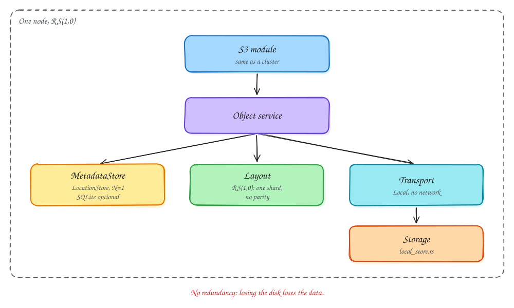
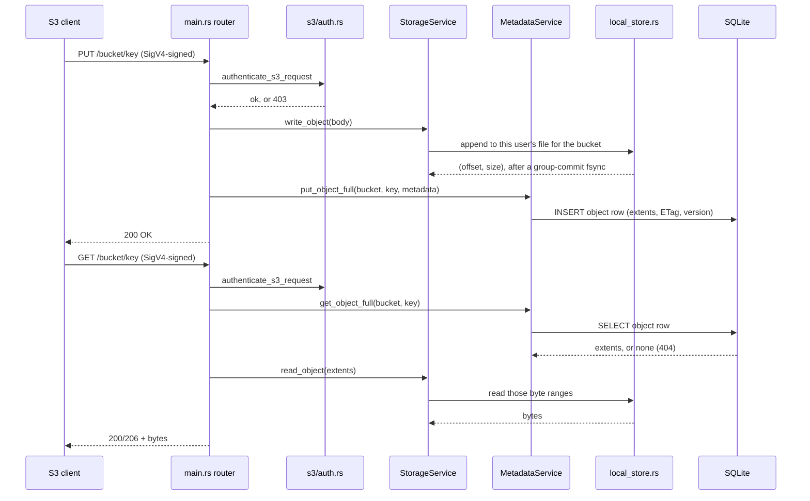
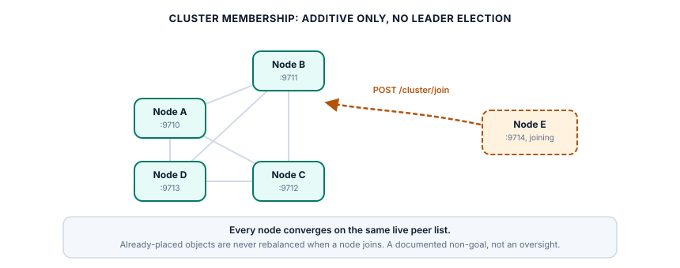
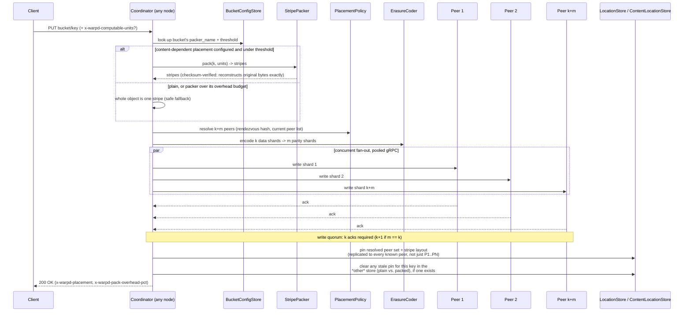
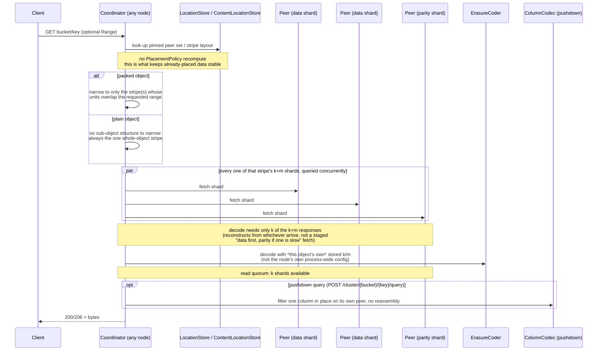

# WarpDrive Architecture Documentation

## Introduction

WarpDrive is an S3-compatible object store for disaggregated data systems
and AI/ML workloads. Its storage layout follows Facebook's Haystack paper:
objects are appended to large files, and a small metadata record points at
each one.

Today one binary contains two engines:

- **Cluster engine** (the default): a multi-node, erasure-coded engine with
  pluggable placement. Any node can coordinate a request. See
  [Cluster engine](#cluster-engine-distributed-mode).
- **Single-node engine**: one process with SQLite metadata. It has the most
  complete S3 implementation. See [Single-node engine](#single-node-engine).

Each has its own S3 handlers, which is why some S3 features work on a single
node but not yet on a cluster. RFC 5 replaces the two engines with one object
service built from pluggable components. See
[Composable design (RFC 5)](#composable-design-rfc-5).

Measured results: [`docs/benchmarks/v1.0.0-results.md`](benchmarks/v1.0.0-results.md).

## Code modules and how they talk

One `warp_drive` binary (`server/src/`) holds both engines. The router sends
a request to the single-node engine when the node has no peers, and to the
cluster engine when it does.

| Module | Role |
|---|---|
| `main.rs` | HTTP routes, picks the engine |
| `s3/` | SigV4 and STS auth, single-node S3 handlers |
| `service/` | Metadata and storage services, background deletion |
| `metadata/` | SQLite metadata: buckets, versions, ACLs, multipart |
| `cluster/s3_surface.rs` | Cluster S3 handlers |
| `cluster/coordinator.rs` | Cluster PUT, GET and DELETE: placement, erasure coding, quorum |
| `cluster/*_store.rs` | Location records, replicated to every node |
| `cluster/*_peer_client.rs` | Moves shards between nodes |
| `storage/` | Append-only bucket files with batched fsync, used by both engines |

### How nodes talk to each other

- **Shards** go to the `k+m` nodes placement picked. A write needs `k` acks
  (`k+1` when `m == k`). A read needs any `k`.
- **Location records** go to every node, so any node can find any object.
- **Internal routes aren't authenticated yet** (#157). Keep them on a
  private network.

## Composable design (RFC 5)

**Status:** proposed. The first performance work is in PR #217. The rest of
this document describes the code as it is today.

One S3 module and one object service, with everything below them pluggable.

| Today | With RFC 5 |
|---|---|
| Two S3 handler sets, single node and cluster | One |
| SQLite on a single node, read-only metadata on a cluster | Replicated `LocationStore` everywhere, SQLite optional |
| A single node is its own engine | A one-node cluster running RS(1,0), no redundancy |
| Shards to self go over the network | `Local` transport on one node |

Each migration step must keep the Ceph suite and the performance benchmarks
from regressing. Details:
[`RFCs/RFC5/RFC5-one-object-service.md`](../RFCs/RFC5/RFC5-one-object-service.md).

## Single-node engine

Used when a node starts without `WARPDRIVE_PEERS` or `WARPDRIVE_JOIN_VIA`.
It has the most complete S3 support ([`TEST-COVERAGE.md`](TEST-COVERAGE.md))
and no redundancy.

### Request sequence (PUT and GET)

Known gap: deleted space is never reclaimed (#218).

## Cluster engine (distributed mode)

Correctness review log: [`docs/reviews/v1.0.0-beta-code-review.md`](reviews/v1.0.0-beta-code-review.md).

Every deployed node is **symmetric**: the same binary, both a storage node
(it stores the shards it receives through the same `local_store.rs` files the
single-node engine uses) and a coordinator that can accept a request, decide
placement, and fan out to peers. There is no
dedicated coordinator process and no leader election: consistent with how
MinIO and SeaweedFS run in production, placement is a deterministic function
of `(bucket, key)`, and consistency comes from a read/write quorum, not
consensus.

The write path and the read path are deliberately asymmetric, so it's worth
looking at them separately, plus a third diagram for how a bucket's
placement/packer choice actually gets wired up across the cluster's nodes.

### Cluster membership and per-bucket placement configuration

Three steps, each building on the last: a node joins the cluster, a bucket's
config picks a placement policy, and that config's `packer_name` selects one
entry from the `StripePacker` registry.

**1. A new node joins the running cluster.** No leader election, no
consensus. The joining node announces itself to every peer it currently
knows about over plain HTTP, best-effort: a peer that's briefly
unreachable during that round simply doesn't get the update, and that gap
isn't automatically repaired later (no gossip, no retry). In practice
(all peers reachable) every node converges on the same list; the failure
mode is a split list after a missed announce, not a hang or an error.

**2. A bucket's config resolves a `PlacementPolicy`.** The live peer list
from step 1, plus the bucket's own `packer_name`/`overhead_threshold_pct`,
feed `ComputedPlacement`'s rendezvous hash to pick the `k+m` peers for this
write.

**3. `packer_name` selects one `StripePacker` registry entry.** A bucket
only ever names a `packer_name`. Swapping in a new packer (native or,
once built, WASM) never changes `coordinator.rs` or any client-visible
behavior, only which registry entry a bucket's config points at.

### Write path

Placement is resolved **fresh** on every write and then pinned. This is
what makes "a node joining later never moves existing data" actually true.

### Read path

GET and DELETE **never** call `PlacementPolicy`. They read the pin that the
write path already recorded, regardless of what the peer list looks like
now.

**What each piece is, concretely (not aspirational, all shipped and tested
unless marked "planned"):**

- **`PlacementPolicy`** (`placement.rs`): `ComputedPlacement`, a CRUSH-style
  deterministic hash of `(bucket, key)` to a `k+m` peer set. Resolved fresh at
  PUT time and pinned into `LocationStore`. GET/DELETE read the pin, so a
  node joining or leaving never moves already-placed data.
- **`StripePacker`** (`packing.rs`): pluggable **content-dependent
  placement**, the opt-in layer on top of the always-on default above.
  `FacPacker` (Fusion's Algorithm 1, size-based bin-packing) and
  `IvfCentroidPacker` (groups by k-means cluster id, then bin-packs
  within each cluster) are both registered implementations of the same
  trait. A bucket picks one via `BucketConfigStore`, or uses neither and
  gets plain erasure-coded storage. Every packer's output is checked the
  same generic, packer-agnostic way before any shard is written: the
  stripes are reconstructed in memory and compared byte-for-byte against
  the original object, catching a dropped/duplicated/misplaced unit
  regardless of which algorithm produced it (not a bespoke check of any
  one packer's own logic). **Planned, not yet shipped:**
  `WasmPacker`: a user-submitted packer compiled to WASM, run sandboxed
  inside the coordinator process (no syscalls/network/filesystem access,
  resource-limited), simulated against a checksum of the original bytes
  for correctness before a bucket is ever allowed to go live on it. Same
  trait, same registry, same call site. Only the authoring path changes.
- **`ErasureCoder`** (`ec.rs`): `ReedSolomonCoder`, the `reed-solomon-erasure` crate
  encode/decode, with a second `encode_shards`/`decode_shards` path for
  pre-packed (content-dependent) stripes.
- **`LocationStore` / `ContentLocationStore`** (Bitcask-style: append-only
  log + in-memory index): the plain object → peer-set pin, and the
  multi-stripe unit → (offset, stripe, peers) record content-dependent
  placement needs, kept as two stores since the record shapes genuinely
  differ.
- **`cluster/s3_surface.rs`**: the cluster's S3 handlers, SigV4-authenticated.
  Covers objects, multipart, tagging, retention and legal hold. Gaps, which
  RFC 5 closes: LIST has no pagination and placeholder ETags, no versions
  (#211), no ACLs, CopyObject stores an empty object (#222), and form POST is
  stored by the single-node engine (#213).
- **`pushdown.rs`**: a `ColumnCodec` trait + a `/query` endpoint that filters
  a column in-place on the peer holding it, no whole-object reassembly.
- **Membership**: additive only (SeaweedFS/MinIO-pool style). A new node
  calls `/cluster/join`, is added to the live peer list, and starts taking
  new writes immediately. Already-placed objects are never rebalanced
  (documented non-goal, not an oversight, see
  `docs/Distributed-Engine-Plan.md`).

Measured results for content-dependent placement, run against this engine
(Lance IVF_PQ vector search, the SIFT1M-small benchmark data, official
TPC-H via DuckDB's `dbgen` and query set) are in
[`docs/benchmarks/v1.0.0-results.md`](benchmarks/v1.0.0-results.md).

