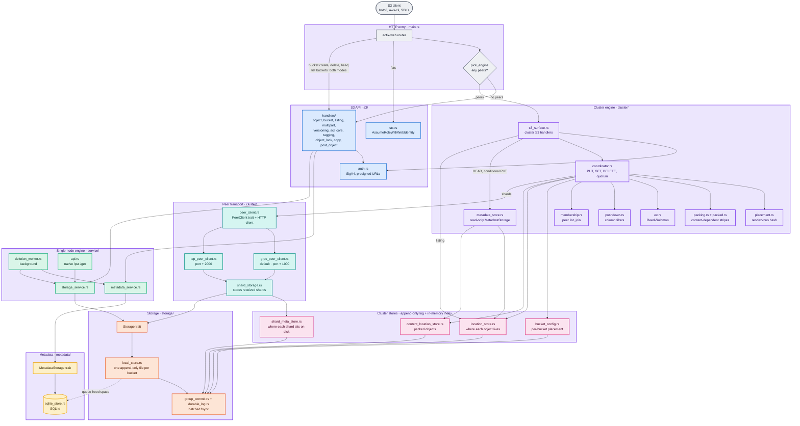
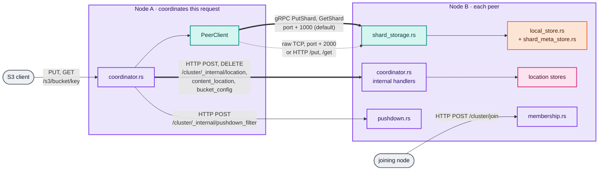
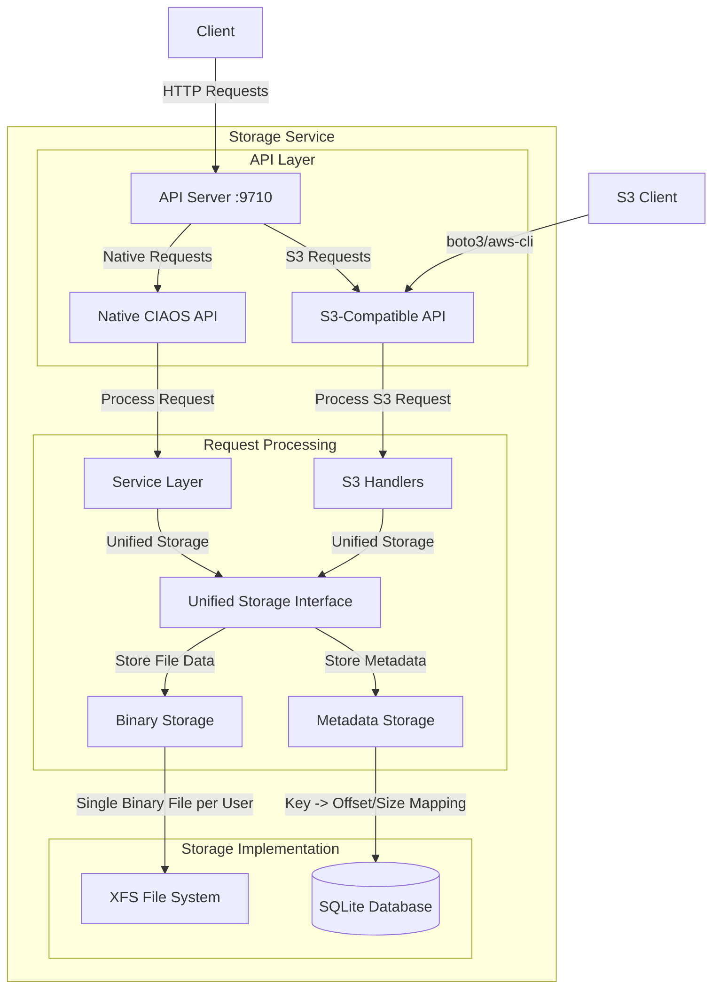
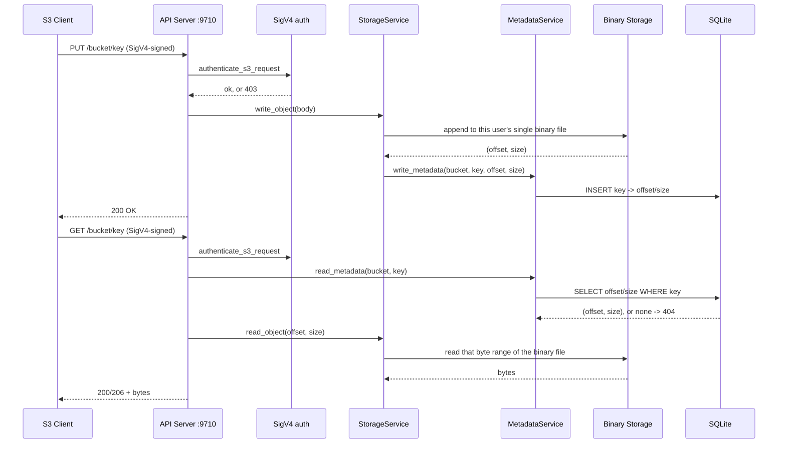
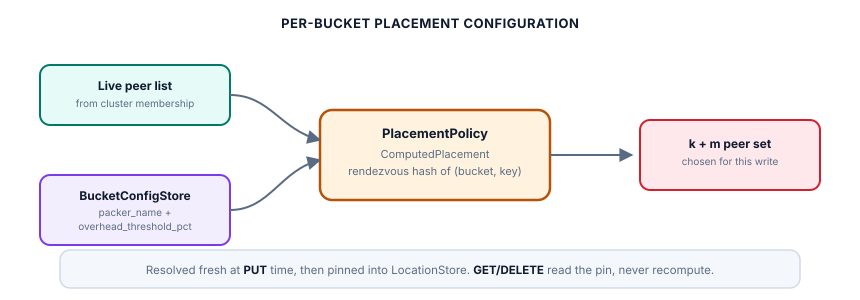
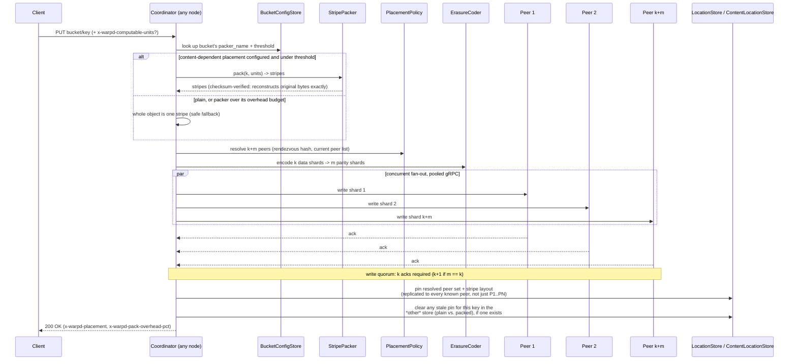
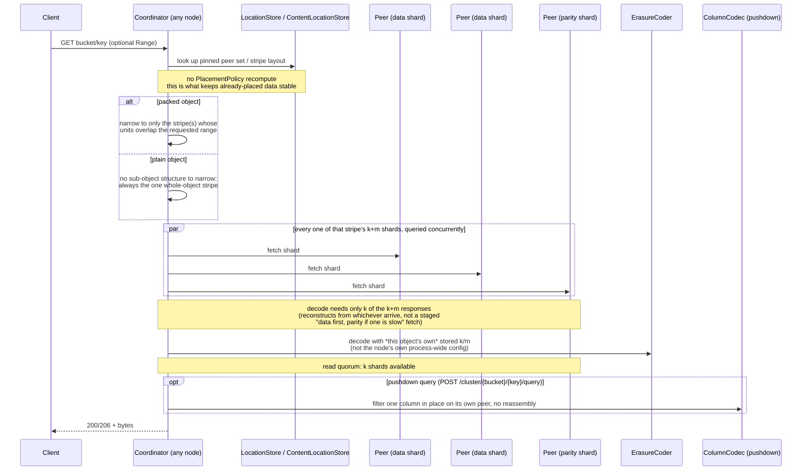

# WarpDrive Architecture Documentation

## Introduction

WarpDrive is a high-throughput key-value/object store optimized for Storage Disaggregated Architectures and AI/ML workloads. The implementation is based on Facebook's 2008 Haystack paper,
focusing on efficient storage and retrieval of objects through a simplified architecture.

As of **v1.0.0-beta**, WarpDrive runs in two modes:

- **Single-node mode**: a single process, fully S3-compatible, for local
  deployments and development. This is the original architecture below,
  unchanged.
- **Distributed mode**: a multi-node, erasure-coded object engine with
  pluggable placement, built as a layer in front of the same single-node
  storage/API code (every peer is still a single-node server underneath).
  See [Distributed Mode](#distributed-mode---v100) below, and the measured
  results in
  [`docs/benchmarks/v1.0.0-results.md`](benchmarks/v1.0.0-results.md).

## Code modules and how they talk

Every node runs the same `warp_drive` binary (`server/src/`). The router in
`main.rs` sends each S3 request to one of two engines. A node with no peers
uses the single-node engine. A node with peers uses the cluster engine,
whose nodes talk to each other directly. Arrows point from the caller to
the module it calls.

| Color | Module | What it does |
|---|---|---|
| gray | `main.rs` | Routes every HTTP request. `pick_engine` sends S3 object requests to the cluster engine when the node has peers, and to the single-node engine when it has none. A node configured for a cluster that hasn't joined yet answers 503. Bucket create, delete and head go to the single-node handlers in both modes. |
| blue | `s3/` | SigV4 and presigned-URL auth (`auth.rs`), STS federation (`sts.rs`), and the single-node S3 handlers (`handlers/`). |
| green | `service/` | The single-node engine: `MetadataService` and `StorageService` behind the handlers, and the background `deletion_worker`. `api.rs` is the native `/put`, `/get` API. It's deprecated for clients, but the HTTP peer transport still uses it. |
| amber | `metadata/` | The `MetadataStorage` trait and its SQLite implementation: buckets, versions, ACLs, multipart uploads, Object Lock and tags. |
| purple | `cluster/` engine | `s3_surface.rs` is the cluster's S3 front end. `coordinator.rs` runs every PUT, GET and DELETE. It picks peers (`placement.rs`), erasure codes (`ec.rs`), packs stripes for content-dependent buckets (`packing.rs`, `packed.rs`), and checks quorums. `metadata_store.rs` exposes the location stores as a read-only `MetadataStorage` for HEAD and conditional PUTs. Listing reads the location stores directly. |
| pink | `cluster/` stores | Records replicated to every node, each an append-only log with an in-memory index: object locations, packed-object locations and bucket placement config. `shard_meta_store.rs` is per node: where each shard it holds sits on disk. |
| teal | `cluster/` transport | `PeerClient` moves shards between nodes over gRPC (default), raw TCP, or HTTP (`WARPDRIVE_PEER_TRANSPORT`). Each node runs the gRPC and TCP shard servers, which store what they receive through `shard_storage.rs`. |
| orange | `storage/` | The `Storage` trait and `local_store.rs`, one append-only file per user and bucket. Both engines write object bytes through it. `group_commit.rs` and `durable_log.rs` batch fsyncs for the stores and logs. |

### How nodes talk to each other

Any node can coordinate a request. The coordinator sends shards to the
nodes that hold them, and sends location records to every node.

- **Shards** go only to the `k+m` nodes that placement picked. A write
  succeeds when `k` of them acknowledge (`k+1` when `m == k`). A read needs
  any `k`.
- **Location records** go to every node, with the same write quorum, so any
  node can find any object without asking another node first.
- **Membership** is additive. A joining node calls `/cluster/join` on a
  peer, gets the peer list back, and announces itself to the rest.
- The `/cluster/_internal/*` routes and the shard ports aren't authenticated
  yet (#157). Keep them on a private network.

## Single-Node Mode (fully S3-compatible, for local deployments) - v0.1.0

### Request sequence (PUT and GET)

Real SigV4 signature verification on every request is exactly what the
distributed mode's minimal `/cluster/s3/` surface (below) does **not**
have. One key, one binary file per user, one metadata row per object. No
quorum, no placement, no erasure coding to reason about here.

## Distributed Mode - v1.0.0-beta

Correctness review log: [`docs/reviews/v1.0.0-beta-code-review.md`](reviews/v1.0.0-beta-code-review.md).

Every deployed node is **symmetric**: the same binary, both a storage node
(the single-node architecture above, unchanged) and a coordinator that can
accept a request, decide placement, and fan out to peers. There is no
dedicated coordinator process and no leader election: consistent with how
MinIO and SeaweedFS run in production, placement is a deterministic function
of `(bucket, key)`, and consistency comes from a read/write quorum, not
consensus.

The write path and the read path are deliberately asymmetric, so it's worth
looking at them separately, plus a third diagram for how a bucket's
placement/packer choice actually gets wired up across the cluster's nodes.

### Cluster membership and per-bucket placement configuration

Three steps, each building on the last: a node joins the cluster, a bucket's
config picks a placement policy, and that config's `packer_name` selects one
entry from the `StripePacker` registry.

**1. A new node joins the running cluster.** No leader election, no
consensus. The joining node announces itself to every peer it currently
knows about over plain HTTP, best-effort: a peer that's briefly
unreachable during that round simply doesn't get the update, and that gap
isn't automatically repaired later (no gossip, no retry). In practice
(all peers reachable) every node converges on the same list; the failure
mode is a split list after a missed announce, not a hang or an error.

**2. A bucket's config resolves a `PlacementPolicy`.** The live peer list
from step 1, plus the bucket's own `packer_name`/`overhead_threshold_pct`,
feed `ComputedPlacement`'s rendezvous hash to pick the `k+m` peers for this
write.

**3. `packer_name` selects one `StripePacker` registry entry.** A bucket
only ever names a `packer_name`. Swapping in a new packer (native or,
once built, WASM) never changes `coordinator.rs` or any client-visible
behavior, only which registry entry a bucket's config points at.

### Write path

Placement is resolved **fresh** on every write and then pinned. This is
what makes "a node joining later never moves existing data" actually true.

### Read path

GET and DELETE **never** call `PlacementPolicy`. They read the pin that the
write path already recorded, regardless of what the peer list looks like
now.

**What each piece is, concretely (not aspirational, all shipped and tested
unless marked "planned"):**

- **`PlacementPolicy`** (`placement.rs`): `ComputedPlacement`, a CRUSH-style
  deterministic hash of `(bucket, key)` to a `k+m` peer set. Resolved fresh at
  PUT time and pinned into `LocationStore`. GET/DELETE read the pin, so a
  node joining or leaving never moves already-placed data.
- **`StripePacker`** (`packing.rs`): pluggable **content-dependent
  placement**, the opt-in layer on top of the always-on default above.
  `FacPacker` (Fusion's Algorithm 1, size-based bin-packing) and
  `IvfCentroidPacker` (groups by k-means cluster id, then bin-packs
  within each cluster) are both registered implementations of the same
  trait. A bucket picks one via `BucketConfigStore`, or uses neither and
  gets plain erasure-coded storage. Every packer's output is checked the
  same generic, packer-agnostic way before any shard is written: the
  stripes are reconstructed in memory and compared byte-for-byte against
  the original object, catching a dropped/duplicated/misplaced unit
  regardless of which algorithm produced it (not a bespoke check of any
  one packer's own logic). **Planned, not yet shipped:**
  `WasmPacker`: a user-submitted packer compiled to WASM, run sandboxed
  inside the coordinator process (no syscalls/network/filesystem access,
  resource-limited), simulated against a checksum of the original bytes
  for correctness before a bucket is ever allowed to go live on it. Same
  trait, same registry, same call site. Only the authoring path changes.
- **`ErasureCoder`** (`ec.rs`): `ReedSolomonCoder`, the `reed-solomon-erasure` crate
  encode/decode, with a second `encode_shards`/`decode_shards` path for
  pre-packed (content-dependent) stripes.
- **`LocationStore` / `ContentLocationStore`** (Bitcask-style: append-only
  log + in-memory index): the plain object → peer-set pin, and the
  multi-stripe unit → (offset, stripe, peers) record content-dependent
  placement needs, kept as two stores since the record shapes genuinely
  differ.
- **`cluster/s3_surface.rs`**: a minimal S3 surface (GET/PUT/HEAD/List)
  over the same coordinator path, built specifically so third-party clients
  that need bucket/list semantics (Lance's `object_store::aws`) work
  unmodified, not just protocol-agnostic range-GET clients (DuckDB's
  `httpfs`, which needs no extra surface). Deliberately minimal, stated plainly: no
  SigV4 verification (any `Authorization` header is accepted unchecked),
  no multipart upload, no LIST pagination, and `ETag`/`LastModified` in
  LIST responses are fixed placeholder values, not real ones. This is a
  distinct, much smaller surface than the single-node `/s3/` API's real
  SigV4-authenticated implementation, not the same compatibility level
  under a different URL prefix.
- **`pushdown.rs`**: a `ColumnCodec` trait + a `/query` endpoint that filters
  a column in-place on the peer holding it, no whole-object reassembly.
- **Membership**: additive only (SeaweedFS/MinIO-pool style). A new node
  calls `/cluster/join`, is added to the live peer list, and starts taking
  new writes immediately. Already-placed objects are never rebalanced
  (documented non-goal, not an oversight, see
  `docs/Distributed-Engine-Plan.md`).

Measured results for content-dependent placement, run against this engine
(Lance IVF_PQ vector search, the SIFT1M-small benchmark data, official
TPC-H via DuckDB's `dbgen` and query set) are in
[`docs/benchmarks/v1.0.0-results.md`](benchmarks/v1.0.0-results.md).

