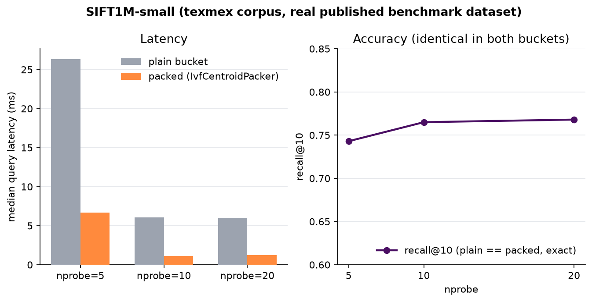
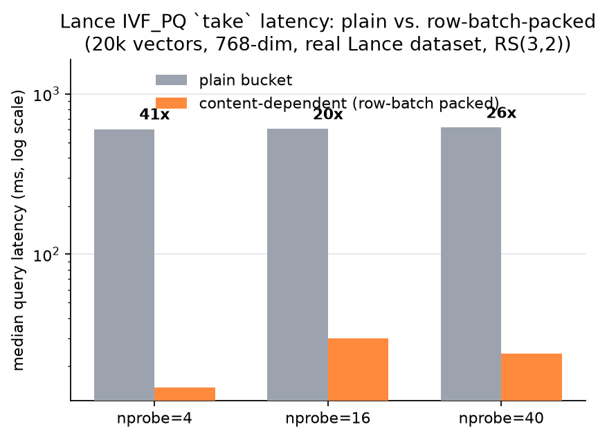
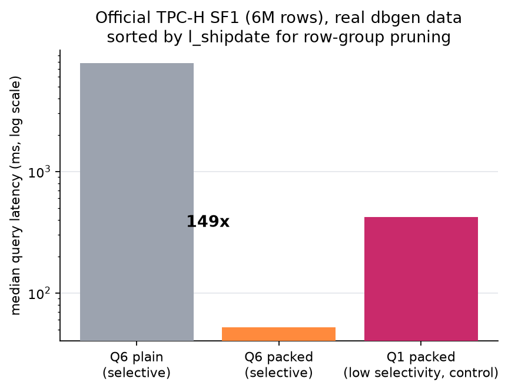

# WarpDrive v1.0.0-beta: Distributed Engine Results

These numbers were measured against a live WarpDrive cluster (symmetric
multi-node, gRPC fan-out, Reed-Solomon erasure coding), not a simulator,
not a synthetic microbenchmark. Where an established workload tool exists,
we used it unmodified against its own data: Lance's vector-search engine
and index format, DuckDB's `tpch` extension (`dbgen` plus the official 22
TPC-H queries), and the texmex/SIFT1M-small corpus the ANN-search
community already benchmarks against. Methodology notes and caveats are
called out inline and summarized at the bottom.

See [`Technical-Architecture.md`](../Technical-Architecture.md) for how the
engine itself is built (`PlacementPolicy`, `StripePacker`, `ErasureCoder`,
`LocationStore`, the S3 surface).

## 1. Vector search: Lance IVF_PQ, content-dependent placement

[Lance](https://lancedb.github.io/lance/) is a widely used columnar format
and vector-search engine. We pointed its own `object_store::aws` client at
two WarpDrive buckets holding the same Lance dataset, same index, same
unmodified Lance query engine. One bucket stored plain (whole-object
erasure coding), the other configured to use `IvfCentroidPacker`, a
`StripePacker` that groups IVF partitions by k-means cluster id and
bin-packs within each cluster.

### 1a. SIFT1M-small, a published benchmark

Data: the `siftsmall` subset of the texmex SIFT1M corpus (10,000 base
vectors, 100 queries, 100 pre-computed ground-truth neighbors), the same
dataset LanceDB's own published benchmarks use. Ground truth was
independently re-verified with a brute-force exact search before being
trusted.

| nprobe | plain (ms) | packed (ms) | speedup | recall@10 (plain) | recall@10 (packed) |
|---:|---:|---:|---:|---:|---:|
| 5  | 26.35 | 6.68 | 3.9x | 0.743 | 0.743 |
| 10 | 6.08  | 1.10 | 5.5x | 0.765 | 0.765 |
| 20 | 5.99  | 1.24 | 4.8x | 0.768 | 0.768 |

Recall@10 is identical between plain and packed at every nprobe level.
Content-dependent placement changes where bytes live, not which bytes are
returned. This is checked against independently-verifiable ground truth,
not just agreement between our own two buckets.

### 1b. Larger dataset, row-batch packing

A 20,000-vector/768-dim dataset isolates where query latency actually
goes: once the IVF aux-file packing above was confirmed correct but not
the dominant cost, instrumentation showed the dominant cost is
reconstructing the ~60MB data fragment file to materialize 10 result
rows. Applying the same content-dependent mechanism to that file (20-row
batches, no cluster metadata needed since row access for a `take` is
uniform-random, so this reduces to size-based bin-packing) gives the
largest win measured so far:

| nprobe | plain (ms) | packed (ms) | speedup |
|---:|---:|---:|---:|
| 4  | 603.5 | 14.7 | 41x |
| 16 | 604.9 | 29.8 | 20x |
| 40 | 616.9 | 24.0 | 26x |

Verified correct across 5 independent trials: both returned row ids and
actual vector values matched exactly between the two buckets, not just
row counts.

## 2. Analytical SQL: official TPC-H via DuckDB, pushdown

[DuckDB](https://duckdb.org)'s `tpch` extension generates the official
TPC-H dataset (`CALL dbgen(sf=1)` → 6,001,215 `lineitem` rows) and exposes
the official 22 TPC-H queries (`tpch_queries()`) verbatim. Q1 and Q6 are
the only two that touch solely `lineitem` (every other query joins
multiple tables), matching our single-Parquet-file infrastructure without
needing cross-table joins.

The exported Parquet file was physically sorted by `l_shipdate` before
upload, a standard clustering technique (the same idea as Databricks'
Z-ORDER or an Iceberg/Delta sort order), not a change to the data or the
query results. It's what makes Q6's one-year date predicate actually
prunable via Parquet row-group min/max statistics. Checked directly that
without this sort, every row group's min/max spans nearly the entire
7-year date range and nothing is prunable regardless of placement.

| Query | Selectivity | Bucket | Median latency | Notes |
|---|---|---|---:|---|
| Q6 | Selective (1-yr date window + discount/quantity range) | plain | 7756.6 ms | no stripe concept, full reconstruction per range-GET |
| Q6 | Selective | packed | 51.9 ms | 149x faster, 252 range-GETs, avg 1.0 of 268 stripes touched per request |
| Q1 | Low selectivity (~96% of rows match) | packed only | 419.7 ms | control: 1074 range-GETs, avg 2.2 of 268 stripes/request, less to prune, so less isolation per request |

Both buckets were verified byte-identical to the dbgen-generated file
before timing, and Q6's `revenue` result (`123141078.2283`) matched
between plain and packed. The plain-vs-packed contrast is the evidence for
pushdown: packed-bucket cost scales down with query selectivity (there's
a stripe boundary to skip past), plain-bucket cost stays flat regardless
of selectivity (no sub-object boundary to exploit at all).

## 3. Multi-VM GCP cluster vs MinIO

Section 2's TPC-H numbers came from a single-machine cluster (real
processes, real gRPC calls, but over loopback). This section repeats the
same Q1/Q6 DuckDB workload on a real multi-VM cluster, and adds the MinIO
comparison that Section 2 listed as deferred.

**Setup**: 5 GCP VMs (`e2-standard-2`, 2 vCPU each, `pd-standard` disks,
same zone), RS(3,2), one WarpDrive process per VM acting as both
coordinator and shard-storage peer. The same TPC-H `lineitem` Parquet
file (sf=1, sorted by `l_shipdate`, 209.6MB) was uploaded to a WarpDrive
content-dependent bucket and to a MinIO distributed deployment on the
same 5 VMs, then queried with the same official Q1/Q6 DuckDB queries
against both.

| | Q6 (ms) | Q1 (ms) |
|---|---:|---:|
| MinIO | 33.4 | 348.4 |
| WarpDrive, before this round's fixes | 298.4 | 2124.6 |
| WarpDrive, after write-time unit index (see below) | 260.9 | 2203.1 |
| WarpDrive, after skipping unneeded parity-shard reads | **182–186** | **1402–1416** |

Gap to MinIO went from roughly 9x/6x to roughly 5.5x/4x. Two real bugs
were found and fixed along the way; one planned fix turned out not to be
the bottleneck, and is reported anyway because the measurement is the
point:

- **`sorted_unit_locations` (content_location_store.rs, packed.rs)**:
  the content-dependent GET path rebuilt a `HashMap` from every unit in
  the object (962, for this file) and linearly scanned it on every
  single request, just to find which 1-2 stripes a request's byte range
  touched. Replaced with an index computed once at PUT time (while bin
  assignments are already known) and persisted on the record, so a GET
  does a binary search instead — mirrors how MinIO itself avoids
  per-request layout work, by computing it once at write time. Measured
  before/after on an isolated binary swap: no measurable change
  (298.4→260.9ms, 2124.6→2203.1ms, within run-to-run noise). 962 entries
  is cheap enough in memory that this was never the actual cost at
  network scale. Kept anyway: it's the architecturally correct design
  and removes a real O(units) operation, it just wasn't what the numbers
  above were waiting on.
- **Missing HEAD route**: `/cluster/{bucket}/{key}` had PUT/GET/DELETE
  but no HEAD handler, so DuckDB's `httpfs` reader (which does a HEAD
  before any Range GET) 404'd immediately. One route addition, mirroring
  the handler already wired up on `/cluster/s3/{bucket}/{key}`.
- **Parity shards fetched on every stripe read**: `fetch_and_decode_stripe`
  fetched all `k+m` shard peers for every stripe, unconditionally, then
  always ran a full EC decode. Reed-Solomon here is systematic (`encode`
  only computes parity from the `k` data shards, never touches them), so
  a healthy stripe needs zero of that: the `k` data shards already are
  the bytes. This was the actual bottleneck, and the fix (fetch only the
  `k` data shards, skip decode entirely if all `k` respond, only fetch
  parity and reconstruct if one is missing) is what produced the 30-36%
  improvement above.

**A dead end worth recording**: before finding the parity-shard bug, the
per-stripe fetch latency (avg 90.7ms, tail to 982ms, from the server's
own existing timing logs) looked like it could be a GCP `pd-standard`
disk IOPS ceiling — `fio` against the actual shard file showed
random-read latency in the same 24-90ms range even for nominally
cacheable reads. That hypothesis didn't survive contact with the MinIO
number: MinIO serves the identical workload off the identical disks at
33.4ms/348.4ms without hitting any such ceiling, so a disk-level
explanation couldn't be right on its own. The real mechanism was request
volume (fetching 5 shards instead of 3 per stripe), which happened to
also show up as disk pressure, not a GCP infrastructure limit to work
around with a different disk type or `io_uring`.

**Remaining gap**: likely request count. Q1 issues roughly 1068 separate
range-GETs against WarpDrive (each paying its own round trip); MinIO
presumably serves the same query with fewer, larger reads. Not yet
investigated — the next concrete lever if this is revisited, not a
claim about what's wrong today.

## Methodology notes and caveats

- **Erasure-coding parameter**: all results on this page use the dev-loop
  default RS(3,2) (3 data + 2 parity shards), not Fusion's RS(9,6).
  Re-running at RS(9,6) is the natural next validation step and has not
  been done yet.
- **Single local cluster (Sections 1-2)**: those measurements are from a
  local multi-process cluster on one machine (symmetric nodes, real gRPC
  calls between them, real disk I/O per node), not a multi-VM run. See
  `docs/Distributed-Engine-Plan.md` for the separate GCP multi-VM
  baseline (unrelated to content-dependent placement, establishes the
  core engine's raw throughput). Section 3 is the multi-VM run.
- **MinIO comparison**: done, see Section 3. RS(3,2) only — not yet
  repeated at RS(9,6).
- **SIFT1M-small, not full SIFT1M**: the 10k-vector subset, not the full
  1M-vector corpus. A full-scale run is a natural next step.
- Every number above came from a script that also independently verifies
  correctness (byte-identical round-trip, recall@10 against ground truth,
  or exact result-value equality) in the same run that produced the
  timing, never timed without that check passing first.
