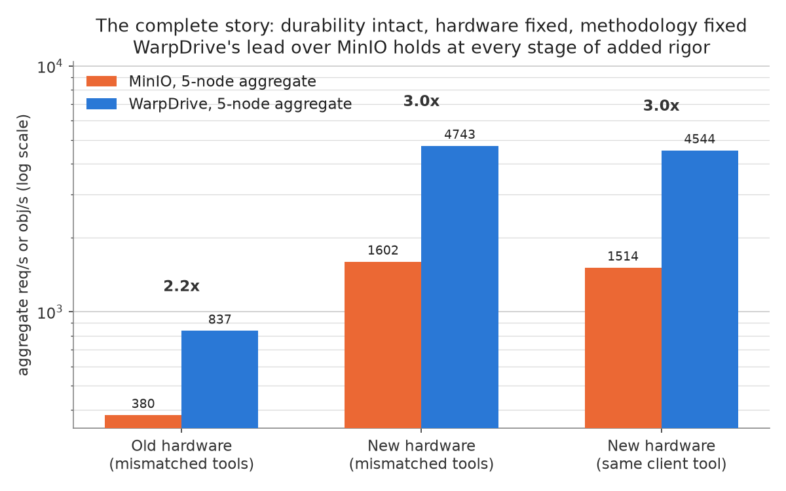
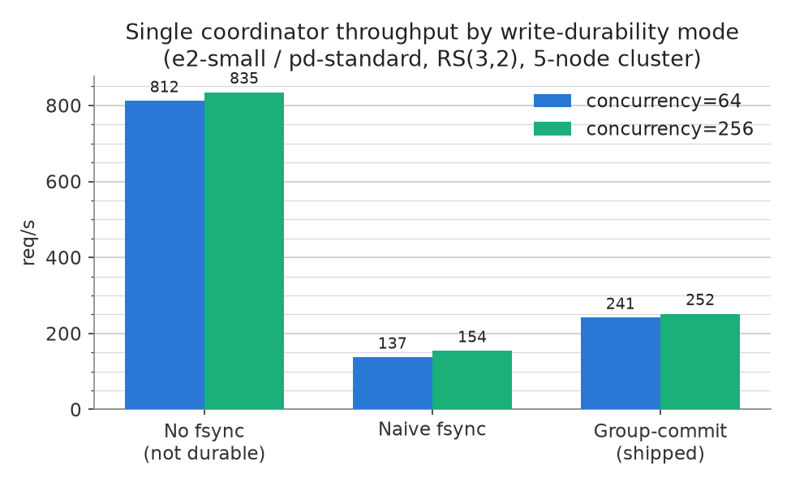
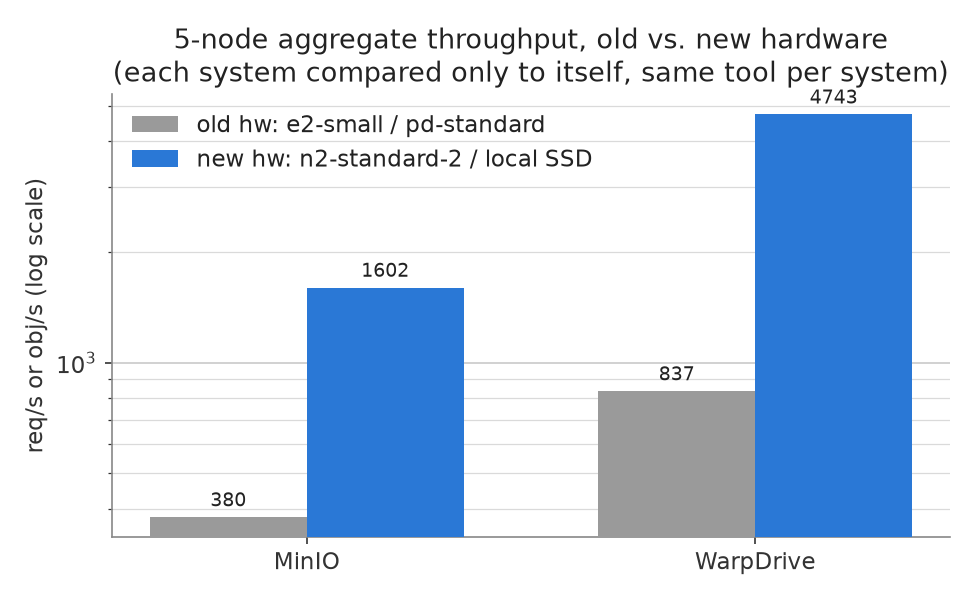
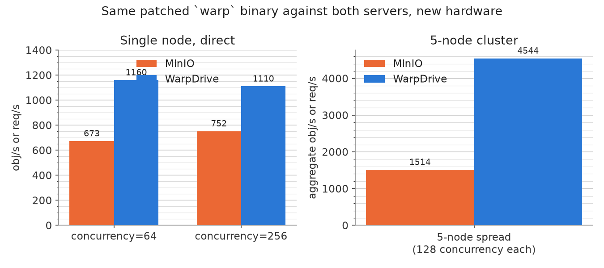

# Write Durability and a MinIO Comparison

This report covers two related pieces of work on the distributed engine: a write-durability gap that was found and fixed, and a throughput comparison against MinIO, run twice on two different hardware generations.

The sections below cover each stage of that chart in detail, in the order the work actually happened.

## 1. The durability gap

No write path in the server, single-node or cluster, called `fsync` anywhere. An acknowledged write was only as durable as the OS page cache until some later, unrelated flush wrote it back. A crash between those two points could lose a write the client had already been told succeeded.

A per-write `fsync` closes that gap but has a cost: measured at 82-89% of throughput on a single coordinator. The fix that shipped instead is a group-commit design. Concurrent writers collapse into one `fsync` per batch rather than each paying for their own, so durability is restored without a fixed timer and without reopening the ack-before-durable window a timer-based approach would create.

| Mode | Concurrency=64 | Concurrency=256 | Durable |
|---|---|---|---|
| No fsync | 811.9 req/s | 834.7 req/s | no |
| Naive per-write fsync | 137.1 req/s | 154.1 req/s | yes |
| Group-commit (shipped) | 241.4 req/s | 251.7 req/s | yes |

Measured on a single coordinator, RS(3,2), 5-node cluster, `e2-small` / `pd-standard` hardware.

## 2. Hardware was part of the original MinIO comparison

An earlier run compared WarpDrive against a MinIO cluster deployed on identical hardware. `vmstat` on a MinIO node during that run showed I/O wait, not CPU saturation, meaning the disk (`pd-standard`, GCP's slowest network-attached tier) was a bottleneck for MinIO on that hardware, separate from either server's own logic.

The fleet was rebuilt on `n2-standard-2` instances with local NVMe SSD instead of `pd-standard`. The chart below compares each system only to itself, old hardware against new, using the same client tool and method on both sides of each system's own comparison.

| | Old hardware (e2-small / pd-standard) | New hardware (n2-standard-2 / local SSD) |
|---|---|---|
| MinIO, 5-node aggregate | 380.2 obj/s | 1601.7 obj/s |
| WarpDrive, 5-node aggregate | 837.4 req/s | 4742.8 req/s |

## 3. A same-client-harness comparison

The original MinIO comparison used `warp` (MinIO's own benchmark tool) for MinIO and a separate custom tool for WarpDrive, two different HTTP clients rather than two different servers under one client. Fixing this turned out to need more than picking one tool: `warp`'s underlying client library, `minio-go`, rejects any endpoint with a path component, and WarpDrive's distributed write path only exists at a non-root path (`/cluster/s3/...`). Pointing `warp` at WarpDrive's root path would have silently benchmarked the single-node handler instead, which has no erasure coding, fan-out, or quorum.

`minio-go` was patched (about 10 lines, via a local `replace` directive, no changes to WarpDrive itself) so its endpoint can carry a path prefix. SigV4 signing needed no separate change: the signer signs whatever path is in the outgoing request, and WarpDrive's signature verification checks against that same request path, so the two already agree.

| Scenario | MinIO | WarpDrive | Ratio |
|---|---|---|---|
| Single node, concurrency=64 | 672.7 obj/s | 1160.2 req/s | 1.72x |
| Single node, concurrency=256 | 752.0 obj/s | 1110.3 req/s | 1.48x |
| 5-node spread, 128 concurrency each (aggregate) | 1513.7 obj/s | 4544.0 req/s | 3.00x |

Zero errors in every run in this report, on both tools, on both servers.

The ratio is smaller on a single node than across the full cluster. Both systems still fan out erasure-coded (or, for MinIO, its own parity-coded) writes across the cluster regardless of which node receives the client's request, so a single-node test does not isolate one node's work from the rest of the cluster's. The ratio widening once the full cluster is in play on both sides is consistent with that, rather than an artifact of one particular run.

## Methodology notes

- RS(3,2) (3 data shards, 2 parity shards) throughout, the project's dev-loop default, not Fusion's RS(9,6).
- Section 3's numbers are the ones to use for any WarpDrive-vs-MinIO claim going forward, since they isolate the server comparison from client-tool differences. Section 1 and 2's numbers are kept as reported because they isolate the durability-mode and hardware-generation comparisons respectively, each on their own terms.
- The GCP account used for this work has a 12-vCPU cap across all regions combined, separate from and lower than its per-region quota. `n2-standard-2` was the largest instance size that fit six nodes under that cap with local SSD attached. Single-node throughput in this report is bound by two vCPUs doing erasure coding, network fan-out, and `fsync` work together, confirmed with `vmstat` showing CPU, not disk, as the limiting resource at that point.
- MinIO ran with its own default parity setting for a 5-drive single pool. Every write in every comparison in this report was fsync'd durably on both systems.
- Section 1's numbers are from the hardware generation used before the upgrade in Section 2. Re-running the durability-mode comparison on the newer hardware is a natural next step, not yet done.
