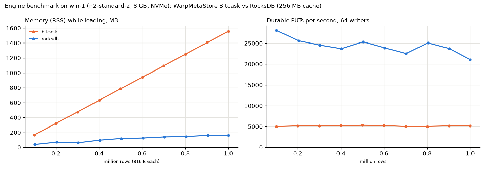
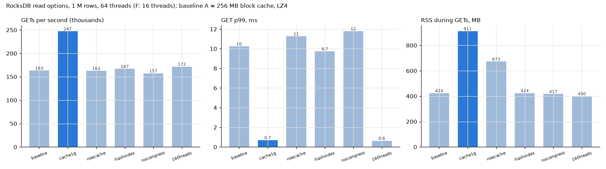

# Metadata engines: WarpMetaStore's Bitcask engine against RocksDB

Question: can RocksDB replace Bitcask as the metadata engine? Bitcask keeps every row in RAM, so a node's memory grows
with the cluster's object count (`../sizing-bitcask`). RocksDB keeps rows on disk and caches hot blocks. Does that cost
throughput?

Engine-level benchmark (`scripts/kvbench`): the same workload through WarpMetaStore's `BitcaskEngine` and through
RocksDB, on wln-1 (n2-standard-2: 2 vCPUs, 8 GB, local NVMe ext4) with nothing else running. 1 M rows of 816 bytes, shaped
like a real object row, from 64 writer threads, every write durable before it returns (Bitcask: group commit; RocksDB:
WAL with sync). Then 30 s of random GETs from 64 threads, 200 prefix scans of 1,000 rows, close and reopen. RocksDB: LRU
block cache (index and filter blocks included), Bloom filters, LZ4, two 64 MB write buffers. Drivers: `scripts/kvb.sh`
(engines), `scripts/kvb2.sh` (read options).

## Bitcask against RocksDB (256 MB cache), `raw/kvb/`

| | Bitcask | RocksDB |
|---|---|---|
| Durable PUTs/s | 5,160 | **21,000-28,000** |
| PUT p50 / p99 | 10 ms / 45-57 ms | **1.9 ms / 5-7 ms** |
| Memory after loading 1 M rows | 1,557 MB, about 1.5 KB more per row | **162 MB** |
| Memory after reopen | 1,974 MB | **208 MB** |
| Reopen | 4.4 s (replays the log) | **0.2 s** |
| On disk | 953 MB | **186 MB** (LZ4) |
| GETs/s | **876,000** | 163,000 |
| GET p50 / p99 | **2 us / 3 us** | 12 us / 10.2 ms |
| Prefix scan of 1,000 rows, p50 | **56 us** | 1.3 ms |

RocksDB is faster at durable writes, holds memory flat, reopens at once and takes a fifth of the disk. Bitcask is
faster at reads, because it returns a row it already holds in RAM, while RocksDB finds the block, decompresses it and
copies the row out.

## RocksDB read options, `raw/kvb2/`

All RocksDB, 1 M rows, in one sweep with the baseline rerun:

| Config | GETs/s | GET p50 | GET p99 | RSS during GETs | PUTs/s |
|---|---|---|---|---|---|
| A: 256 MB block cache (baseline) | 163,000 | 12 us | 10.2 ms | 424 MB | 21,600 |
| **B: 1 GB block cache** | **247,000** | **7 us** | **0.7 ms** | 911 MB | 21,300 |
| C: + 256 MB row cache | 163,000 | 13 us | 11.3 ms | 673 MB | 20,100 |
| D: + hash index in data blocks | 167,000 | 12 us | 9.7 ms | 424 MB | 20,700 |
| E: no compression | 157,000 | 13 us | 11.8 ms | 417 MB | 23,200 |
| F: baseline with 16 threads | 172,000 | 12 us | 0.6 ms | 400 MB | 9,700 |

- **Only the block cache size matters.** At 1 GB the decompressed rows (about 900 MB) fit, so GETs skip decompression: 1.5x
  the GET rate and p99 from 10 ms to 0.7 ms. The cost is the cache's own memory, and memory doesn't grow with rows beyond it.
- Row cache, hash index and no compression change nothing measurable, so none is used.
- The 10 ms GET p99 at 256 MB is 64 threads sharing 2 cores (F: the same cache with 16 threads has a 0.6 ms p99), on
  top of the cache misses.

## What follows

RocksDB is wired in as a WarpMetaStore engine (`WARPDRIVE_META_ENGINE=rocksdb`, branch `feat-rocksdb-meta-engine`),
behind the generic `OrderedKv` interface, and the cluster run (`../sizing-rocksdb`) compares it with Bitcask end to end.
The one setting users get is the block cache size.
