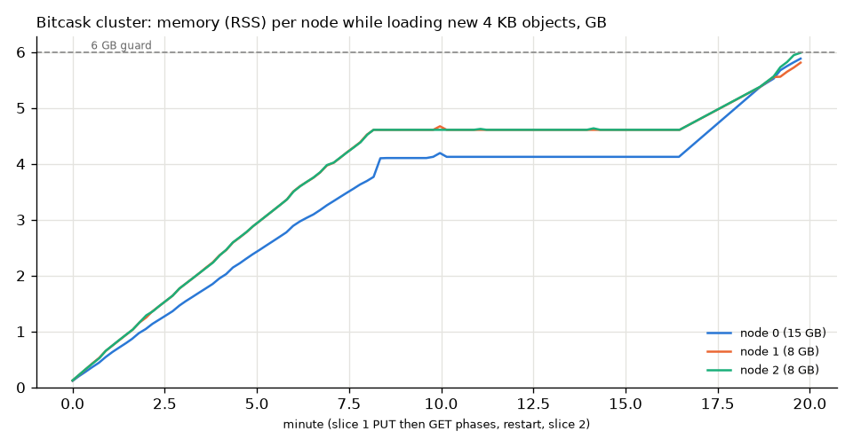

# Sizing: memory per object with the Bitcask metadata engine

Question: how much memory does each object cost a node, and so how many objects fit?

RS(2,1) on the 3 nodes, #224 at 766060b (same binary as soak 3), Bitcask metadata engine (the default at that commit). New
4 KB objects (unique keys, no overwrites or deletes) at 64 clients, in slices: a PUT phase, then a GET phase of the same
length over the keys just written, then every node restarted and its RSS read after 60 s idle. Driver: `scripts/sizing.sh`,
with `scripts/guard6.sh` stopping the load past 6 GB on any node.

**Nodes differ:** node 0 is an n2-standard-4 (15 GB), nodes 1 and 2 are n2-standard-2 (8 GB).

The chart shows RSS during the load phases only: the idle measurements after each restart are in the table.

| Slice | Objects | Idle RSS per node after restart | Startup | Metadata logs | PUT/s (p50, p99) | GET/s (p50, p99) |
|---|---|---|---|---|---|---|
| 1 | 1.72 M | **5.4-5.5 GB** | 23 s | 1.7 GB | 3,435 (17.6, 24.3 ms) | 6,536 (9.4, 13.5 ms) |
| 2 | about 2.0 M (stopped by the 6 GB guard) | 6.0-6.3 GB | 26 s | 2.0 GB | (stopped) | (stopped) |

- **About 3.3 KB of RAM per object on every node.** Every node holds every object's row (metadata is replicated to all
  nodes), as deserialized structs, plus its shard index entries and the blob address index.
- **So an 8 GB node holds about 2 M objects for the whole cluster**, a 15 GB node about 4 M, and adding nodes doesn't help.
  Past that the kernel kills WarpDrive, and it can't restart, because startup rebuilds the same in-memory rows.
- Startup replays the whole metadata log: about 13 s per million objects.

This is why the metadata engine moves to RocksDB (`../metadata-engines`, #235).
