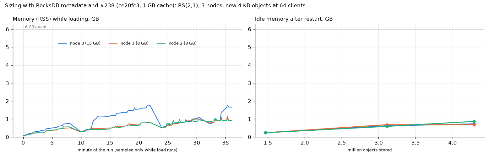

# Sizing: RocksDB metadata with #238 (no per-object memory)

Question: with RocksDB as the metadata engine (#237) and reads taking placements from their rows (#238, no in-memory
address index and no startup rebuild), does a node's memory stay small as objects grow? And what are PUT and GET
against Bitcask and RocksDB alone?

Same VMs and setup as `../sizing-bitcask` and `../sizing-rocksdb`: RS(2,1) on the 3 nodes (node 0 15 GB, nodes 1-2
8 GB), new 4 KB objects at 64 clients, `WARPDRIVE_ROCKSDB_CACHE_MB=1024`. Build ce20fc3: #238 at 58ecf64 merged with
#237 at 10bec1a, plus `S3_BENCH_PUT_ONLY` in `s3_bench`, built on `wlc` from GitHub. Driver `scripts/sizing-combo.sh`:
PUT-only loads, each followed by restarting every node and reading its RSS after 60 s idle, and two perf probes (120 s
of PUTs, then 120 s of GETs over them).

## Memory and startup

| Objects | Idle RSS per node after restart | Startup | Metadata on disk |
|---|---|---|---|
| 1.47 M | **0.25 GB** | **1 s** | 0.37 GB |
| 3.11 M | 0.62-0.71 GB | 1 s | 0.79 GB |
| 4.29 M | 0.71-0.91 GB | 1 s | 1.1 GB |

Against the other two runs, idle after restart:

| Objects | Bitcask | RocksDB alone | RocksDB with #238 |
|---|---|---|---|
| about 1.5 M | 5.4-5.5 GB, 23 s startup | 2.6 GB, 17 s | **0.25 GB, 1 s** |
| about 4.2-4.3 M | (out of memory past about 2 M) | 5.5-5.6 GB, 52 s | **0.71-0.91 GB, 1 s** |

- **Startup no longer grows with objects**: 1 s at every count. The index rebuild was the whole startup cost.
- **Memory still rises, but slowly and slowing**: +0.4 GB over the first 1.6 M objects after 1.5 M, then +0.1 to 0.2 GB
  over the next 1.2 M. The likely cause is RocksDB's block cache filling with index and filter blocks, which the 1 GB
  cache caps. Expected ceiling: about 0.25 GB base + 1 GB cache + about 0.13 GB of write buffers. 4.3 M objects isn't
  enough to show the plateau. A longer run at higher counts would.

## Throughput

| Point | PUT/s (p50, p99) | GET/s (p50, p99) |
|---|---|---|
| Load to 1.47 M | 2,934 (20.8, 39.0 ms) | |
| Probe at 1.5-1.8 M | 2,904 (21.1, 39.3 ms) | 5,080 (12.2, 22.3 ms) |
| Load to 3.11 M | 2,591 (23.2, 49.6 ms) | |
| Load to 4.29 M | 2,947 (20.7, 40.0 ms) | |
| Probe at 4.3-4.7 M | 3,077 (19.9, 37.5 ms) | 4,934 (12.5, 23.5 ms) |

At about the same object count, Bitcask did PUT 3,435 and GET 6,536, and RocksDB alone PUT 2,927 and GET 4,812. So #238
adds about 6% to GET over RocksDB alone and leaves PUT unchanged. Against Bitcask, PUT is about 15% and GET about 22%
lower. Throughput doesn't fall as objects grow. The probes' GETs read the keys written in their own 120 s PUT phase,
where the other runs' GET phases read 500 s worth.

`bench*.csv` columns: phase, bytes, clients, ops, errors, ops/s, mean, p50, p90, p99 (microseconds).
