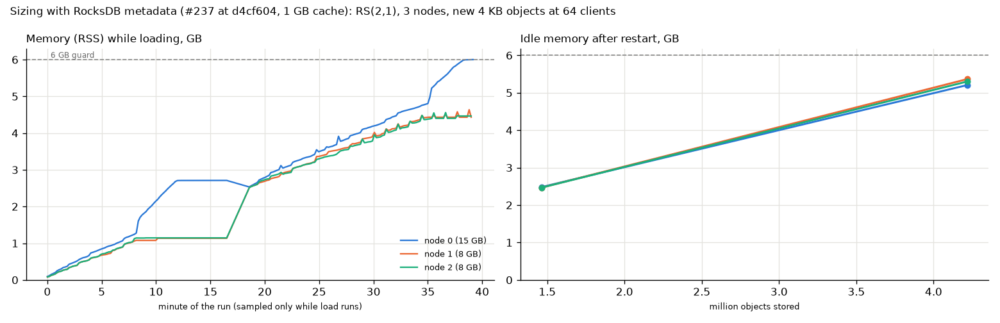

# Sizing: memory per object with the RocksDB metadata engine

Question: with RocksDB as the metadata engine (#237), does a node's memory stay flat as objects grow, and what does it
cost in throughput against Bitcask (`../sizing-bitcask`)?

Same VMs, setup and driver shape as the Bitcask sizing run: RS(2,1) on the 3 nodes (node 0 n2-standard-4 with 15 GB,
nodes 1-2 n2-standard-2 with 8 GB), new 4 KB objects at 64 clients, each slice a PUT phase then a GET phase of the same
length, then every node restarted and its RSS read after 60 s idle. Build: #237 at d4cf604 with
`WARPDRIVE_META_ENGINE=rocksdb` and `WARPDRIVE_ROCKSDB_CACHE_MB=1024`. Driver `scripts/sizing-rocks.sh`, with the 6 GB
guard. Both per-object stores ran on RocksDB on every node (`cluster_metadata.rocks`, `shard_meta.rocks`).

| Slice | Objects | Idle RSS per node after restart | Startup | Metadata on disk | PUT/s (p50, p99) | GET/s (p50, p99) |
|---|---|---|---|---|---|---|
| 1 | 1.46 M | **2.6 GB** | 17 s | 0.37 GB | 2,927 (20.8, 38.5 ms) | 4,812 (12.8, 23.6 ms) |
| 2 | 4.22 M (GET phase stopped by the guard) | **5.5-5.6 GB** | 52 s | 1.08 GB | 2,754 (22.0, 43.7 ms) | (stopped) |

Against Bitcask at 1.72 M objects: 5.4-5.5 GB idle, PUT 3,435/s (17.6, 33.3 ms), GET 6,536/s (9.4, 17.7 ms).

- **Half Bitcask's memory, but memory still grows**: about 1.1 KB per object per node, a third of Bitcask's 3.3 KB.
- **Startup grows with objects** too: 17 s at 1.46 M, 52 s at 4.22 M.
- **Restarting more than doubles memory**: nodes 1-2 used about 1.1 GB while loading slice 1, and 2.5 GB idle after the
  restart. At startup the cluster rebuilt its in-memory blob address index by loading every metadata row at once.
- Both causes are the address index and its rebuild, which #238 removes. `../sizing-combined` measures RocksDB with #238.
- **Cluster throughput is lower than Bitcask's**: PUT 15% and GET 26% at about the same object count. Not profiled yet.

`bench*.csv` columns: phase, bytes, clients, ops, errors, ops/s, mean, p50, p90, p99 (microseconds).
