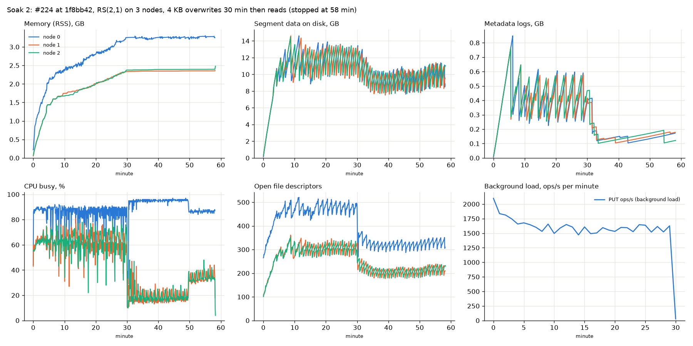

# Soak 2: the same hour on #224 at 1f8bb42

Question: does 1f8bb42 fix what soak 1 (4c2aeeb) found? Soak 1 ran out of memory because gc/ rows stayed in the index
for a day and every pass scanned all of them. 1f8bb42 makes a pass read only the rows that are due, and drops them
once processed.

Same setup and load as soak 1: RS(2,1) on the 3 nodes, 64 MB segments, grace 120 s, servers started with
`ulimit -n 1048576`. `s3_bench` overwrote 100,000 keys of 4 KB at 64 clients for 30 min, then read them.
`scripts/canary.py` (8 threads) ran alongside with its own objects and checked every byte. Each node was sampled every
5 s. Driver: `scripts/soak2.sh`.

**Stopped at minute 58 of 60** (`scripts/soak2-stop.sh`). By then the run had answered its question, and the memory
growth it showed was already found and fixed (below). Soak 3 runs the fix.

## Correctness: held

- Canary: 277,204 checked operations, **all OK**. That's 110,696 PUTs, 110,893 GETs, 13,901 LISTs, 27,938 deletes,
  10,994 multipart uploads and 2,782 aborts. The stop came before its final read-back of every object, so that last
  check didn't run here.
- Background load: 2.92 M overwrites at 1,622/s with **0 errors** (p50 33 ms, p90 65 ms, p99 117 ms). The read phase's
  per-second trace was lost: `s3_bench` writes it when the phase ends, and the stop came first.
- No panics on any node.

## Resources: against soak 1

| Per node | Soak 1 (4c2aeeb), end of writes | Soak 2 (1f8bb42), end of writes | Soak 2, through the reads |
|---|---|---|---|
| Memory (RSS) | 6.9-7.3 GB, OOM-killed at 57 min | 2.3-3.3 GB | **flat** (3.26 → 3.28 GB on node 0) |
| Metadata logs | 3.6 GB, still growing | 0.2-0.6 GB, compacting | 0.1-0.2 GB |
| Segment data | 10-14 GB | 9-14 GB | 8-11 GB |
| Open descriptors | 300-520 | 270-520 | 190-350 |

- **The gc/ row fix works.** The metadata logs go up and back down, and gc/ passes kept up to the end. Every pass
  retired every row it read: about 2,400-2,800 rows every 75 s on node 0, with no backlog.
- **Memory still grew while writing**, by about 0.4 GB per node every 10 min, and stopped when writes stopped. That
  pattern is per-write state. The cause is the in-memory blob address index (`cluster/blob_store.rs`): every write
  added an entry and nothing removed one. Fixed in 766060b: a gc/ pass drops each dead blob's entry. The index still
  grows with live blobs. Removing it altogether is #233.
- CPU on node 0, the node the load and canary talk to, stayed near 95% through the reads, as in soak 1. At minute 50
  it dropped to 87% while nodes 1 and 2 rose from about 18% to 35%. The cause isn't known yet. Soak 3 records the
  same panels, so it can be compared there.

## The final audit

The audit ran seconds after the stop. It reported 1,776-2,991 shards per node (1.3-2.2 GB) that the sweep would free,
where soak 1's after-run audit found 0. This fits gc/ rows that weren't due yet:

- When the stop came, the last pass had covered rows due up to 03:03:25.
- That left about 3 minutes of the canary's deletes and overwrites inside the grace period: about 36 dead shards a
  second on node 0, around 6,800 shards.
- The audit doesn't count pending gc/ rows, so it reports the shards of those written more than 2 minutes earlier as
  reclaimable.

Soak 3 settled it. There the audit waited 240 s after the stop, so every gc/ row was due and processed, and it found
0 reclaimable shards on every node.

## Files

`raw/`: driver progress log (commit and binary sha256), `bench.csv`, `per_second.csv` (PUT phase), per-node samples
`node{0,1,2}.csv` (unix s, RSS KB, fds, -, segment KB, -, metadata KB, CPU %, -), node logs with the gc/ pass lines,
audits, and the canary's `events.csv`.
