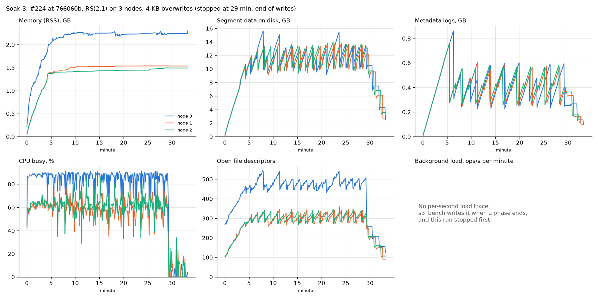

# Soak 3: #224 at 766060b, stopped at the end of writes

Question: does 766060b stop the memory growth soak 2 found? Until then the in-memory blob address index never dropped
dead blobs. 766060b makes a gc/ pass remove each dead blob's entry.

Same setup and load as soaks 1 and 2: RS(2,1) on the 3 nodes, 64 MB segments, grace 120 s. `s3_bench` overwrote
100,000 keys of 4 KB at 64 clients, and `scripts/canary.py` ran alongside and checked every byte. Driver:
`scripts/soak3.sh`.

**Stopped at minute 29**, at the end of the write phase (`scripts/soak3-stop.sh`). Memory had been flat under full
write load for 20 minutes, which answered the question. Before the audit, the stop script waited 240 s so every gc/
row was due and processed.

## Results

| | Soak 2 (1f8bb42) | Soak 3 (766060b) |
|---|---|---|
| Memory, node 0, minute 10 → 30 | 2.40 → 3.26 GB | **2.25 → 2.24 GB** |
| Memory, nodes 1-2, minute 10 → 30 | 1.68-1.75 → 2.33-2.37 GB | **1.42-1.51 → 1.49-1.53 GB** |
| Metadata logs | 0.2-0.6 GB, compacting | 0.2-0.6 GB, compacting |
| Final audit, reclaimable shards | 1,776-2,991 per node (run right after the stop) | **0 on every node** (101,809 shards, all referenced) |
| Canary live checks | 277,204, all OK | 147,361, all OK |
| Panics | 0 | 0 |

- **The leak is fixed.** Memory stops growing about 8 minutes in, once caches fill, and stays flat under full write
  load.
- **gc/ rows account for every dead shard.** With the rows given time to come due, the audit finds nothing to free.
  Soak 2's nonzero audit was rows still inside the grace period when that run was stopped.
- **When writes stop, compaction brings the disk down** from 10-14 GB to about 2.5 GB per node within 4 minutes.

## Not measured here

- The canary's final read-back of every object: its expected state lives only in the process, so stopping it skips
  that step. Its live checks verified every GET and LIST for the whole run.
- Load throughput: `s3_bench` writes its per-second trace when a phase ends, and this run stopped about 40 s before
  that. Soak 2 has the same load's numbers (1,622 PUT/s, 0 errors).
- The read phase.

Memory still grows with the number of live objects (the metadata engine keeps every row in RAM): #235. The blob
address index is still there for live blobs: #233.

## Files

`raw/`: progress log (commit and binary sha256), per-node samples `node{0,1,2}.csv`, node logs with the gc/ pass lines,
audits, and the canary's `events.csv`.
