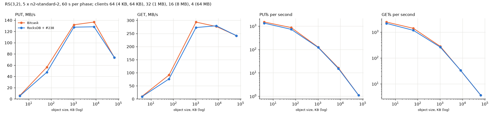

# Object size sweep: Bitcask against RocksDB with #238, RS(3,2)

Question: on the RS(3,2) layout deployments use, what do PUT and GET do from 4 KB to 64 MB, and what does RocksDB with
#238 cost against Bitcask at each size?

Builds (prebuilt, no rebuild): Bitcask = #224 at 766060b (`wd-final3`); RocksDB + #238 = ce20fc3 (#238 at 58ecf64 merged
with #237 at 10bec1a, 1 GB block cache). Each arm on a fresh cluster. Per size: 60 s of new PUTs, then 60 s of GETs over
them, from `s3_bench` on `wlc`, every request to node 0. Clients shrink as objects grow so the data in flight fits the
8 GB nodes. Driver `scripts/sanity32.sh`. 0 errors in every phase.

| Size x clients | Bitcask PUT/s (MB/s) | RocksDB + #238 PUT/s | Bitcask GET/s (MB/s) | RocksDB + #238 GET/s |
|---|---|---|---|---|
| 4 KB x 64 | 1,488 (6) | 1,337 (-10%) | 2,438 (10) | 2,169 (-11%) |
| 64 KB x 64 | 861 (56) | 725 (-16%) | 1,394 (91) | 1,166 (-16%) |
| 1 MB x 32 | 126 (132) | 122 (-3%) | 280 (294) | 260 (-7%) |
| 8 MB x 16 | 16.3 (137) | 15.3 (-6%) | 33.0 (277) | 33.3 (+1%) |
| 64 MB x 4 | 1.13 (76) | 1.13 (0%) | 3.6 (242) | 3.6 (0%) |

p50 and p99 per phase are in `raw/*.csv` (columns: phase, bytes, clients, ops, errors, ops/s, mean, p50, p90, p99 in
microseconds).

- **RocksDB with #238 costs a fixed amount per request**: 10-16% at 4 KB and 64 KB, 0-7% from 1 MB up, nothing at 64 MB.
  The metadata path is slower per request than Bitcask's in-memory rows, and that matters only when the data transfer
  is small. This is where the RocksDB performance work should start.
- **Bytes per second peak at 1-8 MB** (about 130 MB/s PUT, 280-290 MB/s GET) and PUT falls at 64 MB (76 MB/s with 4
  clients: each PUT takes about 3.1 s).
- Against the same cluster shape on 2026-11-20 (#226 at b62e763, Bitcask, 4 KB, 64 clients: 1,121 PUT/s and
  1,628 GET/s), Bitcask at 4 KB is now 33% faster at PUT and 50% at GET.

## Caveats

- **One run per arm, not alternated** (Bitcask first). The trend over sizes is consistent, so the per-request gap is
  real, but single-point differences of a few percent are within run-to-run noise.
- **The client limited some points**: client CPU averaged 20-50% per phase but reached 100% in 1 s samples at 8 MB and
  64 MB (it hashes every payload for SigV4). Large-object MB/s are a lower bound. Both arms equal there.
- **No node CPU or memory samples**: the sampler launch began with `pkill -f '[s]oak_sampler.sh'`, which matched its own
  shell (the same command line names the sampler) and killed it before it started.
