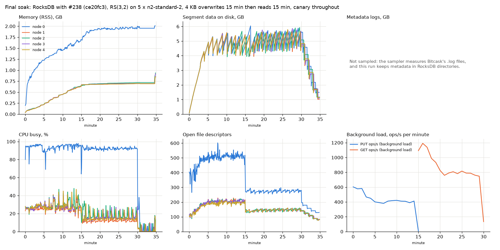

# Final soak: RocksDB with #238 on RS(3,2)

Question: does the release's metadata setup (RocksDB with #238) hold up under sustained overwrites and compaction on
RS(3,2): every byte intact, no errors, disk bounded, memory bounded, nothing left for the audit to free?

Build ce20fc3 (#238 at 58ecf64 merged with #237 at 10bec1a), `WARPDRIVE_META_ENGINE=rocksdb`, 1 GB block cache. RS(3,2)
on the 5 n2-standard-2 nodes, 64 MB segments, grace 120 s. `s3_bench` overwrote 100,000 keys of 4 KB at 64 clients for
15 min, then read them for 15 min, every request to node 0. `scripts/canary.py` ran the whole 30 min (unique bytes per
object, every GET and LIST checked, deletes, multipart uploads and aborts, a full read-back at the end). Then 240 s for
every gc/ row to come due, and the audit sweep on every node. Driver `scripts/soak-final.sh`.

## Result: passed

| Check | Result |
|---|---|
| Canary: 1,655 objects, every live check and a full read-back | 0 mismatches, 0 live-check failures |
| Load: 403,844 overwrites (449/s), then 800,868 reads (890/s) | 0 errors |
| Audit sweep after the grace period, every node | 0 left to free |
| Panics | 0 on every node |
| Segment data per node | flat at 4-6 GB while overwriting, 1.0-1.5 GB at the end |
| Memory per node | storage nodes level at 0.65-0.7 GB from minute 15; node 0 about 2 GB |

## Compaction under load (node 1's gc/ passes)

| Phase | Dead shards freed per pass | Segments compacted / deleted per pass | Freed per pass |
|---|---|---|---|
| Overwriting | 28,000-38,000 (about 500/s, the overwrite rate) | 17-27 / 17-27 | 1.1-1.8 GB |
| Reading (canary only writes) | about 2,050 | 22-25 / 19-25 | 1.3-1.7 GB |

About 22.5 GB freed per node over the run, and the dead-shard count fell to the canary's level within the 2-minute grace
period after the overwrites stopped: no backlog.

## Notes

- Memory on the storage nodes rose while overwriting (RocksDB's cache and write buffers filling as rows are rewritten)
  and stayed flat through the reads. It rose again in the last minutes, to 0.85-0.94 GB, while the audit sweep read
  every shard index entry and row: still inside the 1 GB cache.
- Node 0 serves every request and ran at 90-96% CPU. Throughput is lower than the RS(2,1) soaks (449 against 1,622
  overwrites/s): 2-vCPU nodes, and each object goes to 5 nodes instead of 3.
- The metadata panel is empty by design: the sampler measures Bitcask's `.log` files.
