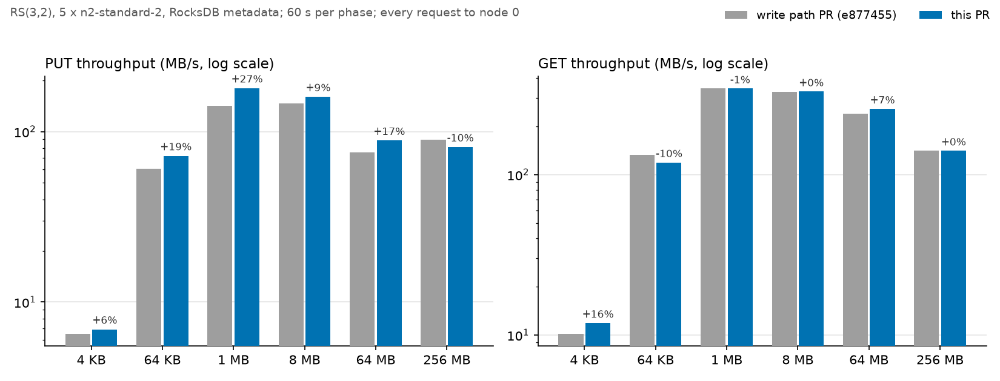

# Object size sweep: the per-byte PUT work PR against the write path PR

Question: what do hardware CRC32C, SIMD Reed-Solomon, assembly MD5 and hashing during the write (branch
`feat-s3-byte-path`, stacked on `feat-s3-write-path`) do to S3 PUT and GET from 4 KB to 256 MB?

Builds, both built on `wlc`:

- base: `feat-s3-write-path` (the PR below this one), same tree as e877455 (`wd-pr`, md5 2e662a1a)
- pr: `feat-s3-byte-path` at f630bbd (`wd-prb`, md5 b011d989)

Setup and method as `../size-sweep-write-path`: setup C, RS(3,2), RocksDB metadata (1 GB cache), fresh cluster per arm,
arms alternated at every size (base, then pr), 60 s PUT then 60 s GET from `s3_bench` on `wlc`, every request to node 0.
Driver `../scripts/sweep.sh` with `A_BIN=wd-pr B_BIN=wd-prb`. 0 errors in every phase.

| Size x clients | PUT/s base | PUT/s PR | GET/s base | GET/s PR |
|---|---|---|---|---|
| 4 KB x 64 | 1,672 | **1,772 (+6%)** | 2,614 | **3,044 (+16%)** |
| 64 KB x 64 | 970 | **1,151 (+19%)** | 2,121 | 1,906 (see reruns) |
| 1 MB x 32 | 141 | **180 (+27%)** | 346 | 344 |
| 8 MB x 16 | 18.3 | **20.0 (+9%)** | 41.0 | 41.2 |
| 64 MB x 4 | 71 in 60 s | **83 in 60 s (+17%)** | 225 in 60 s | 241 in 60 s |
| 256 MB x 2 | 21 in 60 s | 19 in 60 s (see reruns) | 33 in 60 s | 33 in 60 s |

## Reruns (`reruns/`)

64 KB and 256 MB were run again because the first pass showed a GET drop the PR has no reason for and a PUT drop.

| Run | 64 KB PUT/s base / PR | 64 KB GET/s base / PR | 256 MB PUTs base / PR (p50) |
|---|---|---|---|
| first pass | 970 / 1,151 | 2,121 / 1,906 | 21 / 19 (4.1 / 5.4 s) |
| `sweep2r1` | 994 / 1,209 | 2,153 / 2,172 | 21 / 19 (4.1 / 5.4 s) |
| `sweep2r2` | 924 / 1,207 | 1,744 / 1,931 | 22 / 18 (3.9 / 5.5 s) |
| `sweep2r3`, PR first | | | 16 / 18 (6.4 / 5.5 s) |
| `../profile-256mb`, 90 s phases, PR second | | | 24 / 28 in 90 s (6.5 / 5.4 s) |

- **64 KB GET is noise**: the reruns give +1% and +11%. 64 KB PUT is +22% and +31% again.
- **256 MB is within noise, not a slowdown**: with 2 clients a phase holds 16 to 28 requests, and the arm that runs
  second tends to lose a few. The base ranged from 16 to 24 PUTs across runs, the PR from 18 to 28. The PR's p50 stays
  at 5.4 to 5.5 s. Node 0 uses under one of its two cores at this size (`../profile-256mb`), so 256 MB is limited
  by the 2-client load and the client, not by the server's per-byte work.

## Findings

- **PUT is faster from 4 KB to 64 MB**: +6% at 4 KB, +19 to 31% at 64 KB, +27% at 1 MB, +9% at 8 MB, +17% at 64 MB.
  At 8 MB the client's SHA-256 (SigV4 signing) limits it.
- **GET is unchanged from 1 MB up**, as expected: the PR changes the PUT path. The 4 KB GET gain (+16%) is a single run.
