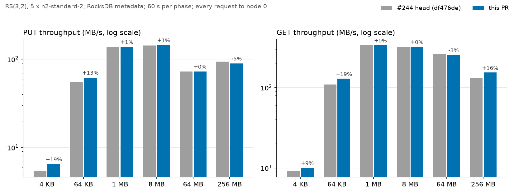

# Object size sweep: the metadata write path PR against #244

Question: what does the metadata write path work (branch `feat-s3-write-path`, stacked on #244) do to S3 PUT and GET
from 4 KB to 256 MB?

Builds, both built on `wlc` from the same toolchain:

- base: #244 head, df476de (`wd-244`, md5 b2d1f694)
- pr: `feat-s3-write-path` at 5476e91 (`wd-pr`, md5 2e662a1a). The pushed head has the same tree with reworded commit
  messages.

Setup C (5 x n2-standard-2, local NVMe, client n2-standard-2), RS(3,2), RocksDB metadata with a 1 GB cache, every
other setting default (inline objects off). Each arm on a fresh cluster, arms alternated at every size (base, pr). Per
size: 60 s of new PUTs, then 60 s of GETs over them, from `s3_bench` on `wlc`, every request to node 0. Clients shrink
as objects grow so the data in flight fits the 8 GB nodes. Driver `../scripts/sweep.sh`. 0 errors in every phase.

| Size x clients | PUT/s base | PUT/s PR | GET/s base | GET/s PR | PUT p50 base / PR |
|---|---|---|---|---|---|
| 4 KB x 64 | 1,394 | **1,655 (+19%)** | 2,365 | **2,580 (+9%)** | 45.9 / 38.5 ms |
| 64 KB x 64 | 876 | **991 (+13%)** | 1,740 | **2,062 (+19%)** | 71.6 / 62.5 ms |
| 1 MB x 32 | 137.7 | 138.5 (+1%) | 335.1 | 336.1 (0%) | 221 / 220 ms |
| 8 MB x 16 | 17.9 | 18.1 (+1%) | 40.2 | 40.3 (0%) | 784 / 775 ms |
| 64 MB x 4 | 1.13 | 1.13 (0%) | 4.10 | 3.98 (-3%) | 3.17 / 3.12 s |
| 256 MB x 2 | 22 in 60 s | 21 in 60 s (-5%) | 31 in 60 s | 36 in 60 s (+16%) | 4.0 / 4.2 s |

`summary.csv` has every phase (ops, errors, ops/s, MB/s, mean, p50, p90, p99). At 256 MB the rate column is rounded to
one decimal, so the table gives the op counts. `utilization.csv` has node 0, nodes 1 to 4, NVMe and client CPU per run.

## Findings

- **The PR speeds up the sizes where the per-request metadata cost matters**: +19% PUT and +9% GET at 4 KB, +13% PUT and
  +19% GET at 64 KB, with PUT p50 down 7 to 9 ms.
- **From 1 MB up the two builds tie** (within 1%, and the 256 MB points are 21 to 36 requests per arm, so a few
  requests either way). The PR doesn't change the per-byte work, which is what limits large objects: see
  `../profile-8mb/NOTES.md`.
- **Node 0 is the limit at every size**: 84 to 97% CPU, against 5 to 29% on nodes 1 to 4, and NVMe 2 to 27% busy. All
  requests go to node 0, which coordinates them.

## Caveats

- One run per arm and size. Run-to-run differences of up to 10 to 15% have been seen on these VMs, so the 4 KB and 64 KB
  gains are larger than the 1 MB+ differences, which are noise.
- The client is part of the limit from 1 MB up: its CPU peaks at 100% hashing payloads for SigV4.
- The samplers cover the whole run (PUT and GET together).
