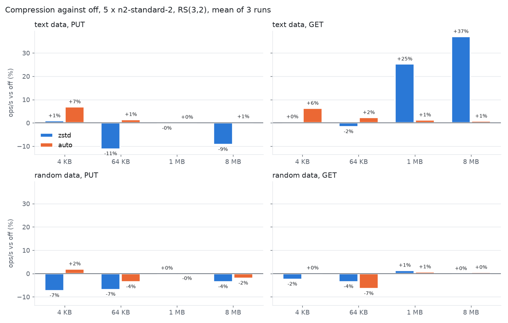
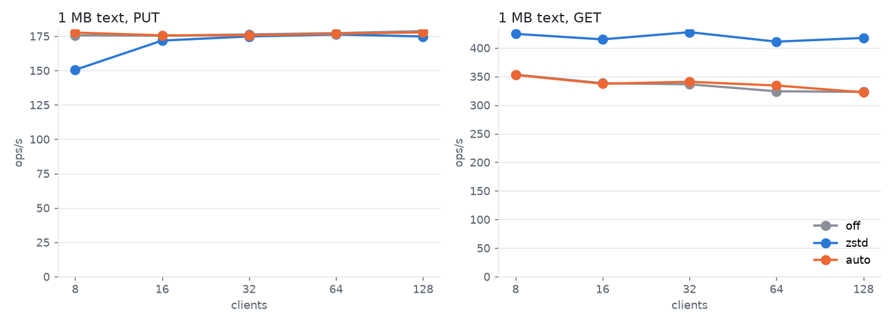

# Compression sweep: off, zstd and auto by size and data

Question: where does compressing shards help or hurt, and does `auto` pick the right side?

Build `wd-base` (#250 at 4891e3f, default flags, see `../builds`). Same setup as `../builds`: 5 x n2-standard-2
(local NVMe), RS(3,2), RocksDB metadata, fresh cluster per run, every request to node 0, `s3_bench` (00e9dde7) on
`wlc`. 60 s PUT then 60 s GET. Text is JSON lines (zstd keeps about a fifth), random is incompressible. Stage
`sweep`: 3 runs per cell, arm order rotated. Stage `clients`: 1 MB text at 8 to 128 clients, 1 run each. Driver
`../scripts/zs3.sh`, numbers `derived.csv` and `means.csv` (`../scripts/derive3.py`), plots `sweep.png` and
`clients.png` (`../scripts/plot_sweep.py`). 0 errors in all 102 runs.

Mean of 3 runs, ops/s, off / zstd / auto:

| Data, size, clients | PUT | GET |
|---|---|---|
| text 4 KB, 64 | 1,703 / 1,718 / 1,820 | 2,610 / 2,622 / 2,774 |
| text 64 KB, 64 | 1,205 / 1,071 / 1,223 | 2,031 / 1,997 / 2,078 |
| text 1 MB, 32 | 176.6 / 176.2 / 177.1 | 340 / 425 / 344 |
| text 8 MB, 16 | 19.3 / 17.5 / 19.4 | 40.2 / 55.1 / 40.5 |
| random 4 KB, 64 | 1,778 / 1,647 / 1,813 | 2,745 / 2,678 / 2,752 |
| random 64 KB, 64 | 1,235 / 1,150 / 1,190 | 2,134 / 2,059 / 1,995 |
| random 1 MB, 32 | 176.4 / 176.7 / 176.3 | 337 / 342 / 339 |
| random 8 MB, 16 | 19.6 / 18.9 / 19.2 | 40.2 / 40.2 / 40.2 |

## Findings

1. **zstd pays off on GETs of large text: +25% at 1 MB and +37% at 8 MB.** Bytes sent by the cluster per GET
   drop from 2.3 MB to 1.3 MB (1 MB) and from 18.7 MB to 10.1 MB (8 MB).
2. **zstd costs PUTs at 64 KB (-11%) and 8 MB (-9%) on text, and 4 to 7% on random data.** PUTs here are
   CPU-bound on node 0 (93 to 97% busy below 1 MB, 93% with zstd at 1 MB against 70% off).
3. **`auto` behaves like off.** It compressed about 3% of writes at every size (`raw/*-decisions.txt`), because
   node 0's CPU was 82 to 98% busy and the 10 Gb/s link was at most 30% busy. So it avoids the PUT cost and also
   misses the GET gain on large text. Its model weighs read savings by reads per write (about 2 here), but the
   GET gain is not taken off a busy CPU. The gain is in fewer bytes per GET on the read side.
4. **Differences at 4 KB are noise.** The min to max spread over 3 runs is about 10 to 25% of the mean
   (`means.csv`), larger than any arm's gap.
5. **1 MB PUTs are flat at about 176 ops/s from 8 to 128 clients for every arm.** So 8 clients already saturate
   it, and zstd cutting bytes sent per PUT from 1.35 MB to 0.27 MB does not move it. The limit is not the
   cluster network, and node 0 is at 70% CPU with compression off. What caps it is not measured here (the
   client's CPU and node disks were not sampled in this run). 1 MB GETs are flat too: about 335 off and 420 zstd.

## What this means for one-round PUTs

Shards now travel with the metadata row (#252), so a PUT's messages get larger. On this LAN, the network is not
the limit, and `auto` stays off. The case to retune `auto` for is the geo network (Azure round trips): there the
link time per byte matters more, and GETs of large text gain 25 to 37% from zstd even on a LAN.
