# WarpDrive performance and capacity, November 2026: consolidated report

Every experiment run on GCP between 2026-11-20 and 2026-11-23 for the release that brings #217 (one object service),
#226 (cluster S3 parity, async I/O), #224 (RFC 6 compaction), #234 (lifecycle), #237 (RocksDB metadata) and #238 (reads
carry placements). Each section names its folder: that folder has the raw data, the exact driver, a `NOTES.md` with the
full setup, and the plots shown here.

How to read the numbers:

- All requests go to node 0, which coordinates. Node 0's CPU is the limit in almost every run.
- Throughput is requests per second at the client count stated. p50 and p99 are per request.
- Comparisons are within one run on the same VMs unless the section says otherwise. Differences between separate runs
  of up to 10-15% can be noise.

## Setups

| Name | VMs | Erasure code | Used for |
|---|---|---|---|
| A, 2026-11-20 | 5 x n2-standard-2 (2 vCPU, 8 GB, local NVMe) + client n2-standard-2 | RS(3,2) | #217 against #226, 4 KB |
| B, 2026-11-21 to 22 | node 0 n2-standard-4 (15 GB), nodes 1-2 n2-standard-2 (8 GB), local NVMe, and client n2-standard-4 | RS(2,1), or single node | async I/O, segments, compaction, soaks, sizing |
| C, 2026-11-23 | 5 x n2-standard-2 + client n2-standard-2 | RS(3,2) | final size sweep and soak |

The project's cap is 12 vCPUs, which sets these shapes. Hardware and software per VM: each date folder's `environment/`.

---

## 1. #217 against #226 on small objects (setup A)

`2026-11-20-gcp-4kb/`. 4 KB objects, 10 min PUT then 10 min GET, then a sweep from 32 to 512 clients.

- **Run 1 found a #226 regression**: GET 410/s against #217's 3,197/s, decaying over the run. Cause: an O(n) scan in
  the blob cache's LRU and only 2 HTTP workers. Fixed in b62e763.
- **Run 2, after the fix**: #226 PUT matches #217 (1,017 against 1,001/s), GET rose 3.6x to 1,474/s, still under #217's
  2,553/s.
- **At saturation the coordinator's CPU is the limit** (92-99% busy, NVMe at most 40%). #226 PUT scales to 1,225/s at
  512 clients with no errors. #217 collapses to 452/s with 85,757 errors.

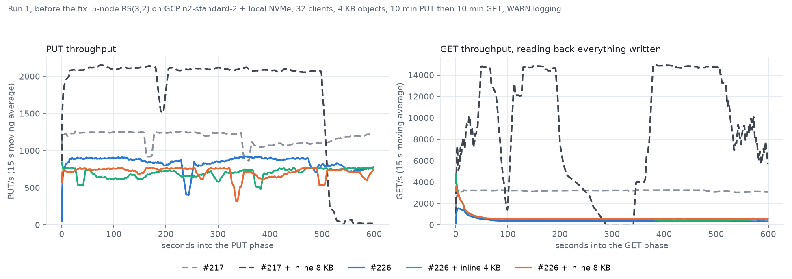
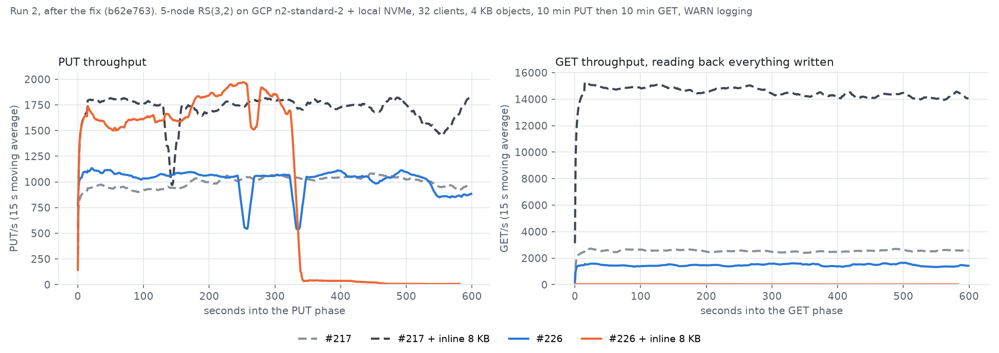
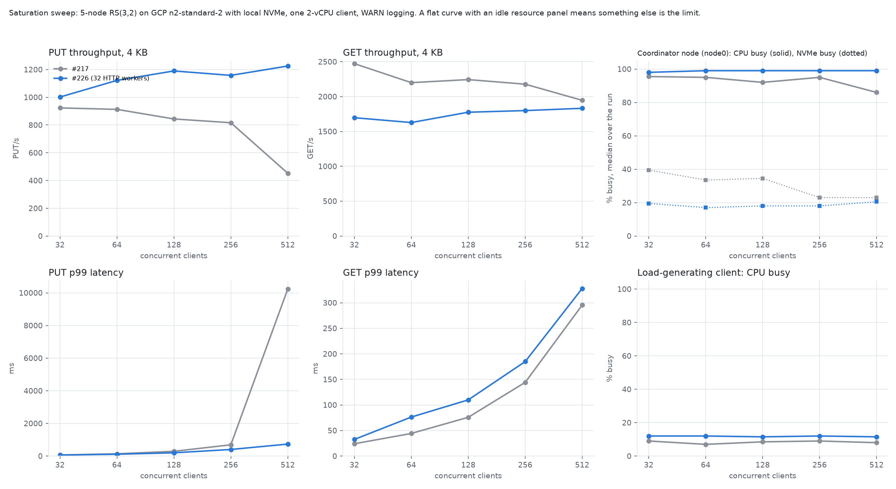

## 2. Where the CPU goes (setup B)

`2026-11-21-gcp-cores/`.

- **Cores**: on RS(2,1), node 0 goes 32-41% faster with 4 cores than with 2. A single node isn't CPU-bound.
- **CPU per request**: 85-90% is thread hand-offs, gRPC to peers, allocation and HTTP. The storage work is 5-15%.
- **Awaiting shard reads on the HTTP worker** closed half the cluster GET gap (+12%) and became #226's default.

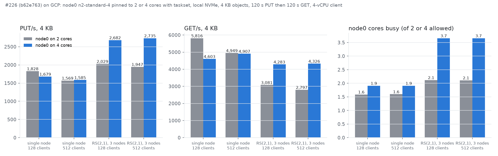
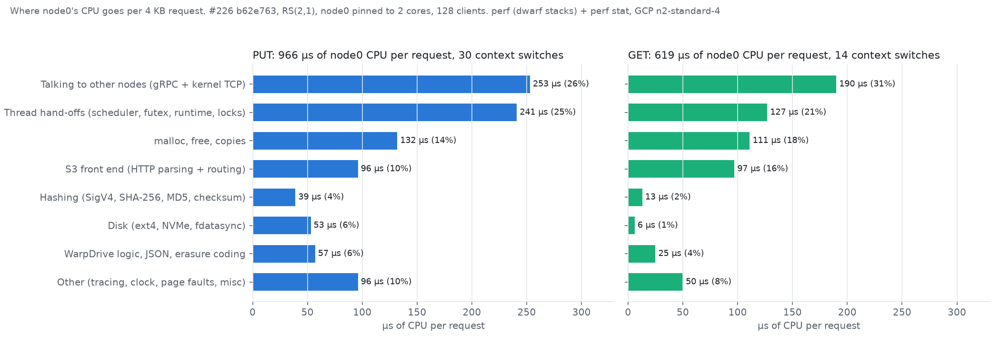

## 3. #226: async I/O and the GET gap (setup B)

`2026-11-22-gcp/workers-ab`, `get-cpu-profile`, `async-io-ab`.

- **32 HTTP workers cost GETs**: with 4 workers (one per core) GET matched main, but cluster PUT fell 38%, because a
  PUT's metadata write blocked its worker for a replication round.
- **The profile**: #226 did 2.2x main's context switches per GET and 30% more CPU per GET (719 against 552 us), from
  threads parked on network I/O handing off to each other.
- **The fix, every request path awaiting its I/O with one worker per core**:

| RS(2,1) | main | #226 before | #226 async |
|---|---|---|---|
| 4 KB PUT/s | 2,563 | 2,826 | **3,659** (+43% over main) |
| 4 KB GET/s | 6,662 | 5,275 | 6,241 (-6%) |
| 1 MB PUT/s | 222 | 262 | 241 |
| 1 MB GET/s | 369 | 575 | 523 |

Single node matches main at 4 KB. The remaining 6% at 4 KB GET is spread over many per-request costs.

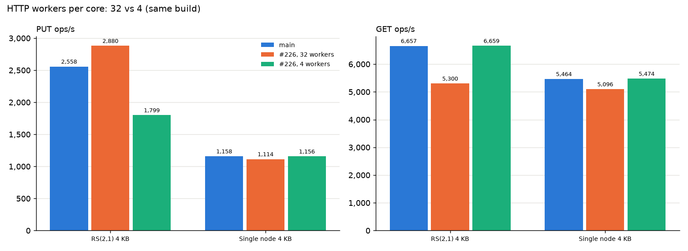
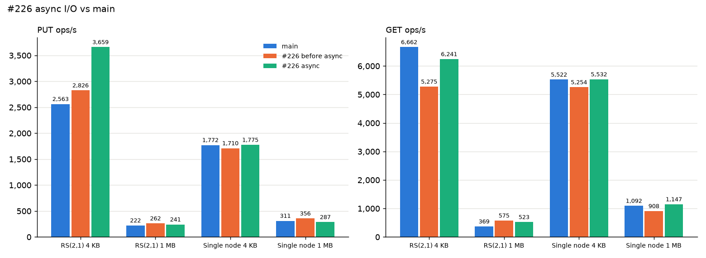

## 4. RFC 6: segments (setup B)

`2026-11-22-gcp/segments-ab`, `oversize-ab`.

- **64 MB segment files cost nothing** against one file per bucket, at 4 KB and 1 MB, single node and RS(2,1).
- **Objects at and past the segment size**: segments write 30-33% faster at 128 and 256 MB objects (a shard with its own
  file flushes only itself).
- **A GET of a blob over 256 MB re-reads the whole blob per 8 MB slice**: 500 MB took about 254 s. Issue #230, after the
  release.

| Object | PUT, segments | GET |
|---|---|---|
| 64 MB | 1.01 s | 0.59 s |
| 128 MB | 2.04 s | 1.27 s |
| 256 MB | 4.00 s | 2.60 s |
| 500 MB | 8.64 s | **254 s** (#230) |

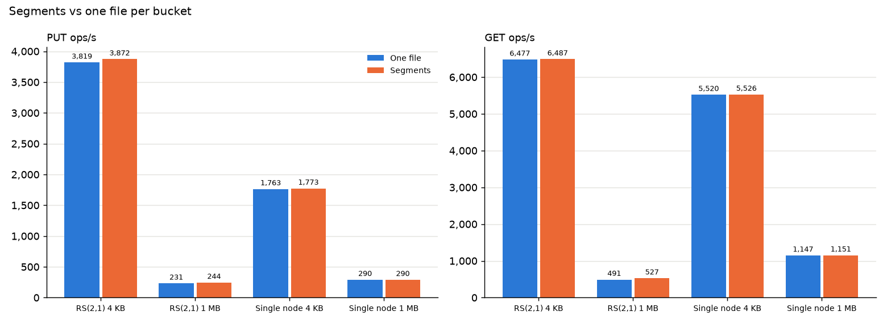
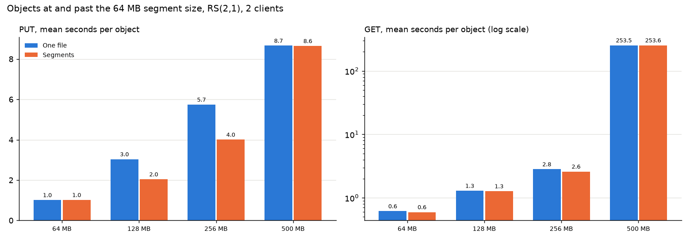

## 5. RFC 6: compaction (setup B)

`2026-11-22-gcp/compaction-run1`, `compaction-run2`. Steady overwrites for 10 min, then 10 min of reads.

**Run 1, the first compactor (sweep-driven)** found two problems, both fixed:

- Sweeps stalled 4 KB PUTs (3,700/s to about 400/s) by scanning every metadata row under a read lock. Fixed with chunked
  scans.
- A sweep took about 10 min at 900,000 shards per node, so disk ran to 33-40 GB against 0.5 GB live. Fixed by gc/ rows:
  writes record the blobs they kill, and the sweep became a daily audit.
- Without freeing, segment handles hit the open-file limit (19,892 failed PUTs). Fixed: handles capped at 4,096 and the
  limit raised at startup (#229).

**Run 2, fixed sweep against gc/ rows:**

| Workload | Free path | PUT/s | PUT p99 | Disk at end of writes | At end |
|---|---|---|---|---|---|
| 4 KB, 100,000 keys | sweep | 2,784 | 244 ms | 11.1x live | 1.02x |
| | **gc/ rows** | 2,795 | **99 ms** | **7.5x** | 1.25x |
| 1 MB, 1,000 keys | sweep | 229 | 221 ms | 69x | 1.00x |
| | **gc/ rows** | 224 | 228 ms | **53x** | 1.01x |
| 256 MB, 20 keys | both | 0.38 | 4.6 s | 4.5x | 1.00x |

- gc/ rows keep disk a third lower during writes and 4 KB PUTs steady, at about 11 points more CPU.
- 256 MB shards have their own segment files, so dead ones are deleted whole: nothing copied.
- **Free disk needed while overwriting: write rate x (grace + 1 to 2 min).**

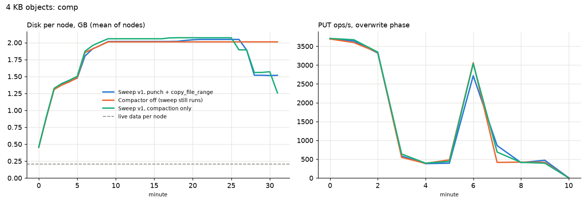
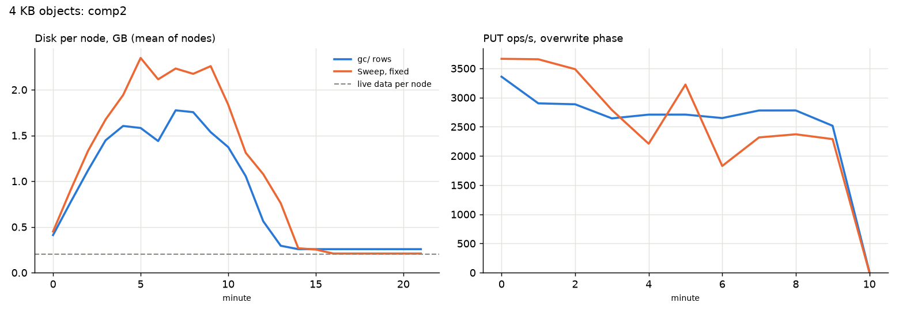
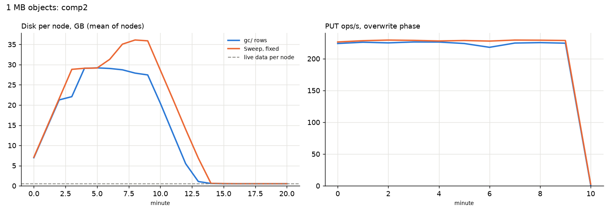
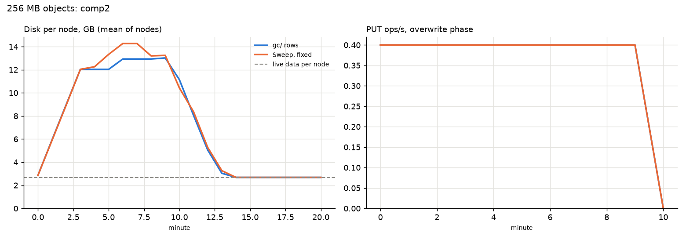

## 6. Soaks: an hour of load with a byte-checking canary (setup B)

`2026-11-22-gcp/soak1`, `soak2`, `soak3`. 4 KB overwrites over 100,000 keys, then reads, with `canary.py` checking every
byte throughout.

| Soak | Build | Correctness | Memory | Fix |
|---|---|---|---|---|
| 1 | 4c2aeeb | held: 1,639 objects, 0 mismatches | **killed for memory** at minute 57: gc/ rows kept for a day, and every pass scanned all of them | 1f8bb42: passes read only the rows due and drop them |
| 2 | 1f8bb42 | held: 277,204 checks, 0 failures | metadata flat, but memory still grew while writing: the blob address index never dropped dead blobs | 766060b |
| 3 | 766060b | held: 147,361 checks, 0 failures | **flat under full write load**, and the audit finds 0 to free | |

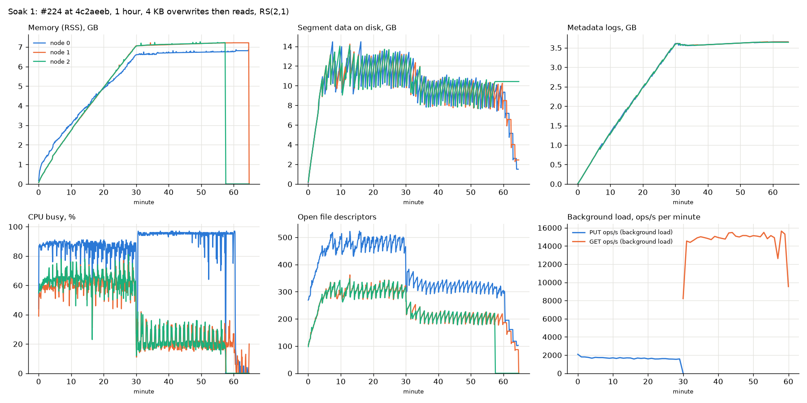
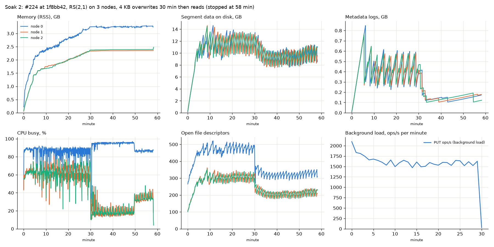
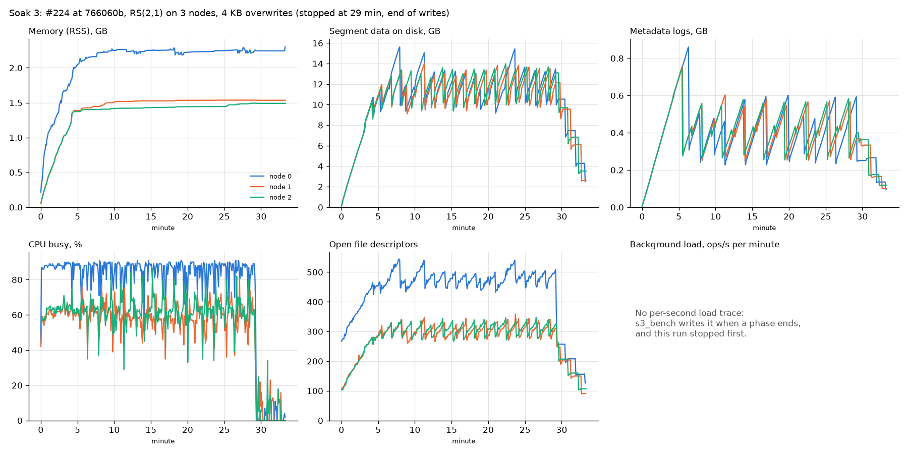

## 7. Memory per object and the metadata engine (setup B)

`2026-11-22-gcp/sizing-bitcask`, `metadata-engines`, `sizing-rocksdb`, `sizing-combined`. New 4 KB objects in slices,
every node restarted after each slice and its memory read idle.

**Bitcask kept every object's metadata in RAM on every node: about 3.3 KB per object**, so an 8 GB node held about 2 M
objects for the whole cluster, and a node out of memory couldn't restart.

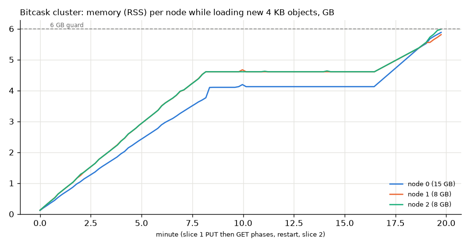

**At the engine level** (1 M rows of 816 B, 64 writers, durable writes), RocksDB writes 4x faster with flat memory, a
0.2 s reopen and a fifth of the disk, and reads slower. Only the block cache size changes its reads:

| | Bitcask | RocksDB, 256 MB cache | RocksDB, 1 GB cache |
|---|---|---|---|
| Durable writes/s | 5,160 | 21,600 | 21,300 |
| Memory after 1 M rows | 1,557 MB, growing | 162 MB | about 900 MB once full |
| Reads/s (p99) | 876,000 (3 us) | 163,000 (10 ms) | 247,000 (0.7 ms) |
| Reopen | 4.4 s | 0.2 s | 0.2 s |

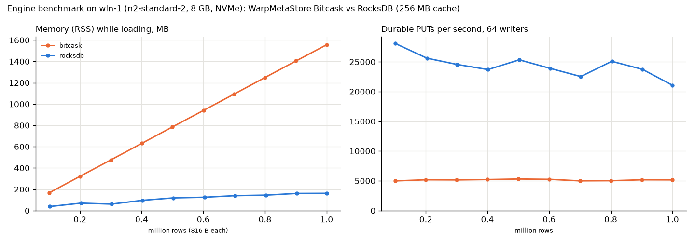
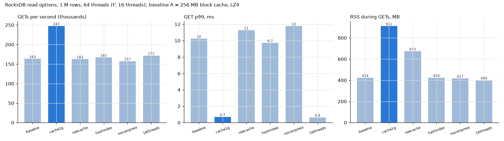

**In the cluster**, RocksDB alone halved memory but still grew, from the in-memory blob address index and its rebuild at
startup. #238 removes both:

| Idle memory per node after restart | Bitcask | RocksDB (#237) | RocksDB with #238 |
|---|---|---|---|
| about 1.5 M objects | 5.4-5.5 GB, 23 s startup | 2.6 GB, 17 s | **0.25 GB, 1 s** |
| about 4.2-4.3 M objects | out of memory past about 2 M | 5.5-5.6 GB, 52 s | **0.71-0.91 GB, 1 s** |
| PUT/s at about 1.5 M (p99) | 3,435 (33 ms) | 2,927 (39 ms) | 2,904 (39 ms) |
| GET/s at about 1.5 M (p99) | 6,536 (18 ms) | 4,812 (24 ms) | 5,080 (22 ms) |

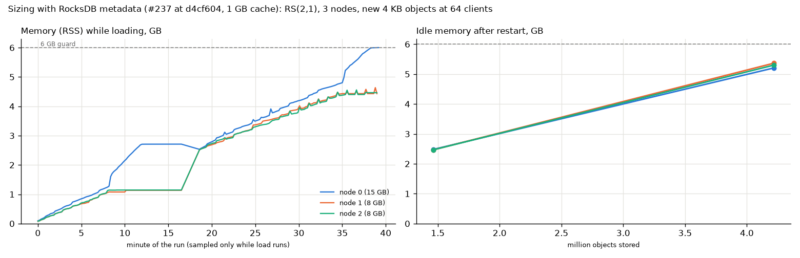
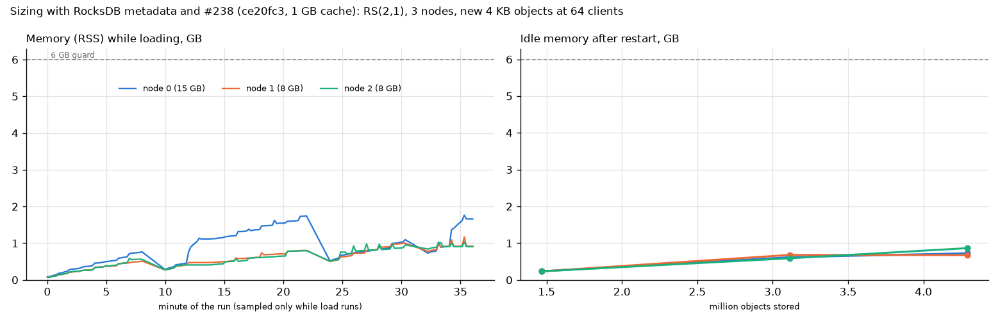

## 8. Final checks on RS(3,2) (setup C)

`2026-11-23-gcp-rs32/size-sweep`, `soak`. Bitcask against the release's setup, RocksDB with #238.

**Object sizes**, 60 s of PUTs then 60 s of GETs each:

| Size x clients | Bitcask PUT/s (MB/s) | RocksDB + #238 | Bitcask GET/s (MB/s) | RocksDB + #238 |
|---|---|---|---|---|
| 4 KB x 64 | 1,488 (6) | -10% | 2,438 (10) | -11% |
| 64 KB x 64 | 861 (56) | -16% | 1,394 (91) | -16% |
| 1 MB x 32 | 126 (132) | -3% | 280 (294) | -7% |
| 8 MB x 16 | 16.3 (137) | -6% | 33.0 (277) | +1% |
| 64 MB x 4 | 1.13 (76) | 0% | 3.6 (242) | 0% |

RocksDB costs a fixed amount per request: visible on small objects, gone on large ones.

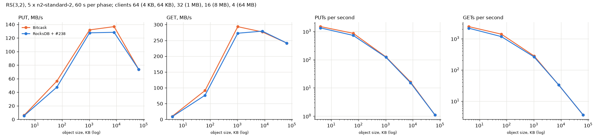

**Final soak, 30 min, RocksDB with #238: passed.** Canary 1,655 objects with 0 mismatches, 0 errors over 403,844
overwrites and 800,868 reads, the audit found 0 to free on every node, 0 panics. Compaction freed about 22.5 GB per node
while segment data stayed at 4-6 GB, keeping pace with about 500 dead shards a second.

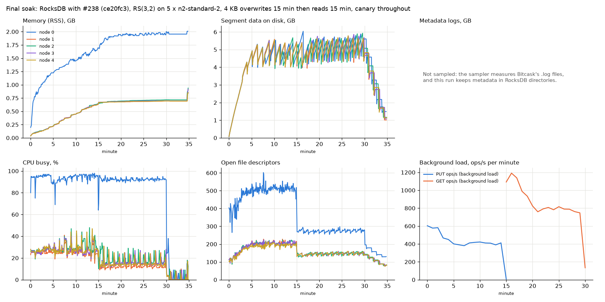

---

## What users of this release should expect

Measured on 2-vCPU and 4-vCPU GCP VMs with local NVMe, every request through one node. Larger machines and spreading
clients over nodes should do better. These are measurements, not guarantees.

| | Expect |
|---|---|
| Durability | every write synced before it's acknowledged, and erasure-coded across nodes (default RS(3,2): a fully written object survives the loss of any 2 nodes. A write acknowledged with fewer shards isn't repaired yet, #206) |
| Correctness under load | 0 mismatches and 0 errors in every soak and canary run |
| Memory per node | flat with object count: under 1 GB at 4.3 M objects (plus the RocksDB cache you configure) |
| Startup | about 1 s, at any object count measured |
| Disk while overwriting | live data plus write rate x (grace period + 1 to 2 min) |
| Small objects, RS(3,2), 2-vCPU nodes | about 1,300-1,500 PUT/s and 2,200-2,400 GET/s at 4 KB |
| Large objects, RS(3,2), 2-vCPU nodes | about 130 MB/s PUT and 250-290 MB/s GET from 1 to 8 MB |
| Objects over 256 MB | PUT works up to about 512 MB on RS(2,1). GET of a blob over 256 MB is very slow (#230) |

## Known gaps, tracked

| Gap | Issue |
|---|---|
| RocksDB metadata costs 10-16% on small objects against Bitcask: not profiled yet (likely JSON decoding per read) | follow-up |
| GET of a blob over 256 MB re-reads the whole blob per slice | #230 |
| PUT of very large bodies exceeds the per-shard message cap | #228 |
| Metadata tombstones are never removed | #236 |
| Cluster-internal endpoints are unauthenticated | #157 |
| Writes acknowledged with fewer than k+m shards are never repaired | #206 |
| Every request goes through one coordinator node in these tests | measure with clients spread over nodes |
